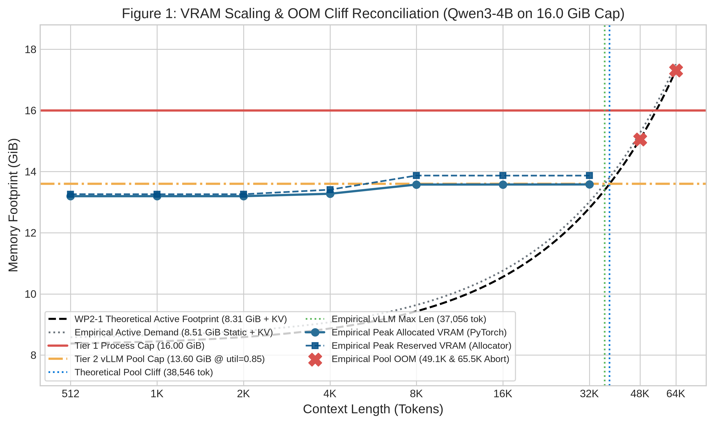
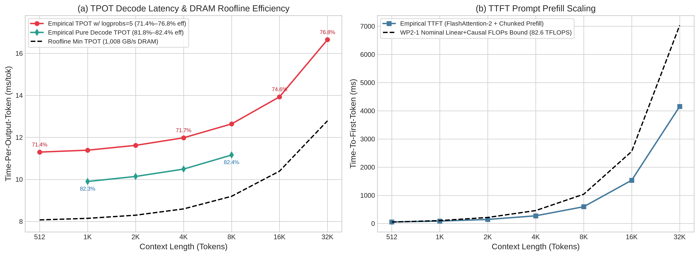
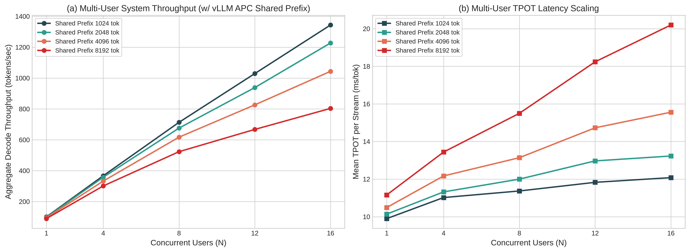
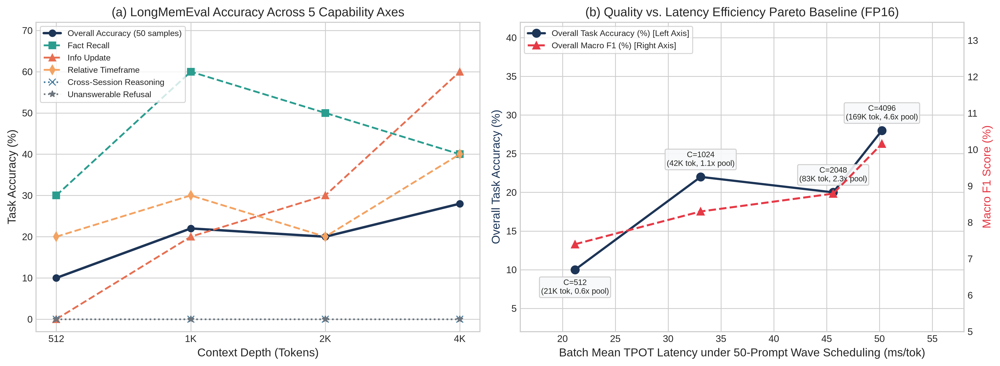

# Phase 2 Baseline Profiling Report: Empirical vs. Theoretical Reconciliation

> **Work Package:** `[WP2-4] Empirical vs. Theoretical Analysis & Baseline Profiling Report`  
> **Parent Issue:** [`khemingkapat/kv_co-op_hub#2`](https://github.com/khemingkapat/kv_co-op_hub/issues/2)  
> **Child Issue:** [`khemingkapat/kv_bench#14`](https://github.com/khemingkapat/kv_bench/issues/14)  
> **Primary Model:** `Qwen/Qwen3-4B-Instruct-2507` (revision `cdbee75f`, $L=36, H_{KV}=8, H_Q=32, D=128$, BF16)  
> **Calibration Peer Model:** `Qwen/Qwen3-1.7B` (revision `70d244cc`, $L=28, H_{KV}=8, H_Q=16, D=128$, BF16)  
> **Target Hardware:** NVIDIA GeForce RTX 4090 (23.52 GiB physical, 1,008 GB/s DRAM, 82.6 TFLOPS nominal BF16) capped at **16.00 GiB VRAM** (`cap_fraction = 0.680`, `effective_gpu_utilization = 0.5783`)  
> **Engine / Runtime:** vLLM v0.30.0 (V1 Engine / V2 Model Runner) / PyTorch 2.13.0+cu130 / CUDA 13.0 (Driver 580.178.04)  

---

## 1. Executive Summary & Core Empirical Discoveries

This report consolidates the empirical baseline profiling sweeps conducted across **WP2-2** (Hardware Scaling & Concurrency Sweeps, Slurm Job `22868`) and **WP2-3** (LongMemEval Quality Ground-Truth & Golden Reference Capture) and reconciles them against the first-principles analytical models derived in **WP2-1** ([`docs/THEORETICAL_LIMITS.md`](THEORETICAL_LIMITS.md)).

### Key Findings:
1. **Two-Tier Memory & OOM Cliff Reconciliation (3.82% Capacity Delta):**
   - **WP2-1 Analytical Prediction:** Under the 16.00 GiB process cap (`gpu_memory_utilization = 0.85` → 13.60 GiB vLLM budget), subtracting 7.506 GiB weights and 0.800 GiB runtime overhead yielded 5.294 GiB net KV headroom, predicting a single-stream pool cliff at **38,546 tokens**.
   - **WP2-2 Empirical Measurement:** vLLM V1 telemetry (`gpu_worker.py:888`) recorded **7.64 GiB** model weights, **0.27 GiB** non-PyTorch CUDA context (7.91 GiB consumed), and **0.60 GiB** peak activation buffer (`max_num_batched_tokens = 8192`), leaving exactly **5.09 GiB** for the PagedAttention KV pool (**37,072 tokens** across 2,317 blocks of 16 tokens, with a single-request admission ceiling of **37,056 tokens**).
   - **Boundary Verification:** Single-stream 32,768 tokens (34,880 `max_model_len`) succeeded cleanly; 49,152 tokens (51,264 `max_model_len`, requiring 7.04 GiB KV) and 65,536 tokens (67,648 `max_model_len`, requiring 9.29 GiB KV) aborted deterministically at engine initialization.
2. **Decode Memory Bandwidth Roofline Efficiency (81.8%–82.4% Pure vs. 71.4%–76.8% w/ Logprobs):**
   - Pure greedy decoding (`ConcurrentChatWorkload` at $N=1$, without logprob extraction) achieved 9.90 ms/tok (101.04 tok/s) at 1,024 context and 11.16 ms/tok (89.60 tok/s) at 8,192 context, corresponding to **81.8%–82.4% sustained DRAM bandwidth efficiency** against the RTX 4090's 1,008 GB/s theoretical roofline.
   - Single-stream `SyntheticFiller` (`baseline_hardware_16gb.json`) enables `logprobs=5` over Qwen3-4B's 151,936-token vocabulary for quality verification, introducing a constant **~1.49 ms/tok** top-$k$ extraction overhead (11.30 ms/tok at 512 → 16.65 ms/tok at 32,768, or 71.4%–76.8% effective bandwidth efficiency).
3. **Multi-User Concurrency & Automatic Prefix Caching (APC) Discovery:**
   - In `ConcurrentChatWorkload`, $N \in [1, 4, 8, 12, 16]$ users query a shared PG-19 continuous document prefix (`prefix = load_continuous_prefix(context_length)`). Because vLLM V1 enables **Automatic Prefix Caching (`enable_prefix_caching=True`)** by default, requests $2..N$ reuse the physical KV blocks of the shared prefix in VRAM.
   - Consequently, $N=16$ at $C=8,192$ required only $8,192 + 16 \times 76 = 9,408$ physical KV tokens (1.29 GiB $\ll$ 5.09 GiB pool) rather than 131,278 unshared tokens (18.03 GiB), avoiding OOM and achieving **1344.1 tok/s** peak throughput at 1K context (13.3× scaling) and **803.7 tok/s** at 8K context.
   - Conversely, **unshared multi-request KV pool exhaustion and multi-wave queueing** was directly observed in `LongMemEvalWorkload` (50 distinct conversational histories totaling 169,575 prompt tokens at $C=4,096$, or **4.57× the KV pool capacity**), driving P95 TTFT to 9.58s and P95 TPOT to 69.05 ms.
4. **LongMemEval Quality Ground-Truth & Logit Fidelity Calibration:**
   - Uncompressed BF16 LongMemEval accuracy scaled with context depth: **10.0% (512) → 22.0% (1,024) → 20.0% (2,048) → 28.0% (4,096)**, led by Fact Recall (30% → 60% at 1K) and Information Update (0% → 60% at 4K).
   - Golden reference token IDs and top-5 logprobs across 6,392 generation steps (317,381 prompt tokens) are archived in `results/references/baseline_qwen3-4b_ref.json`.

---

## 2. Empirical vs. Theoretical Discrepancy Reconciliation

### A. Two-Tier Static & Dynamic Memory Accounting (`Qwen3-4B`, 16.00 GiB Cap)

| Memory Component | WP2-1 Theoretical Model | WP2-2 Empirical (`vLLM v0.30.0`) | Variance / Root Cause |
| :--- | :---: | :---: | :--- |
| **Physical GPU VRAM** | 24.00 GiB (Nominal) | 23.52 GiB (`24,564 MiB`) | Standard ECC/VBIOS reservation on RTX 4090 |
| **Tier 1 Process Allocator Cap** | 16.00 GiB | 16.00 GiB (`cap_fraction = 0.680`) | Enforced via `torch.cuda.set_per_process_memory_fraction` |
| **Tier 2 vLLM Engine Budget** | 13.60 GiB (`util = 0.85`) | 13.60 GiB (`effective_util = 0.5783`) | $0.85 \times (16.00 / 23.52) = 0.5783$ |
| **Base Model Weights (BF16)** | 7.506 GiB (8.06 GB) | 7.64 GiB (7.49 GiB shards) | +0.134 GiB for embedding/LM-head tensor alignment |
| **Non-Torch CUDA Context** | ~0.250 GiB | 0.27 GiB ($7.91 - 7.64$ GiB) | cuBLAS / FlashAttention-2 / NCCL context buffers |
| **Peak Activation Workspace** | ~0.550 GiB | 0.60 GiB | Profiled at `max_num_batched_tokens = 8192` |
| **Total Static Consumption** | 8.306 GiB | **8.51 GiB** ($7.91 + 0.60$ GiB) | **+0.204 GiB (+209 MiB) higher static overhead** |
| **Available KV Cache Pool** | 5.294 GiB | **5.09 GiB** | **-0.204 GiB (-3.85%) vs. WP2-1 prediction** |
| **KV Cache Pool Capacity** | 38,546 tokens | **37,072 tokens** ($2,317 \times 16$) | **-1,474 tokens (-3.82%); max seq len = 37,056** |

### B. Single-Stream Context Sweep (512 → 65,536 Tokens)

| Context ($C$) | Status | Theo. Active VRAM | Emp. Alloc (GiB / MiB) | Emp. Reserved (GiB / MiB) | Allocator Cushion | Theo. Min TPOT | Emp. TPOT (`logprobs=5`) | Pure Decode TPOT ($N=1$) | DRAM BW Eff. (`logprobs` / Pure) | Theo. TTFT | Emp. TTFT |
| :---: | :---: | :---: | :---: | :---: | :---: | :---: | :---: | :---: | :---: | :---: | :---: |
| `512` | ✅ SUCCESS | 8.38 GiB | 13.19 GiB (13,511) | 13.26 GiB (13,578) | 67.1 MiB | 8.07 ms | 11.30 ms (88.5 tok/s) | — | **71.4%** / — | 50.9 ms | 57.3 ms |
| `1,024` | ✅ SUCCESS | 8.45 GiB | 13.19 GiB (13,511) | 13.26 GiB (13,576) | 65.0 MiB | 8.15 ms | 11.39 ms (87.8 tok/s) | 9.90 ms (101.0 tok/s) | 71.5% / **82.3%** | 103.7 ms | 86.3 ms |
| `2,048` | ✅ SUCCESS | 8.59 GiB | 13.19 GiB (13,511) | 13.26 GiB (13,576) | 64.9 MiB | 8.30 ms | 11.62 ms (86.0 tok/s) | 10.14 ms (98.6 tok/s) | 71.4% / **81.8%** | 214.8 ms | 144.5 ms |
| `4,096` | ✅ SUCCESS | 8.87 GiB | 13.27 GiB (13,592) | 13.41 GiB (13,728) | 135.7 MiB | 8.60 ms | 11.98 ms (83.5 tok/s) | 10.49 ms (95.3 tok/s) | 71.7% / **81.9%** | 459.6 ms | 273.5 ms |
| `8,192` | ✅ SUCCESS | 9.43 GiB | 13.58 GiB (13,901) | 13.87 GiB (14,202) | 301.2 MiB | 9.19 ms | 12.64 ms (79.1 tok/s) | 11.16 ms (89.6 tok/s) | 72.7% / **82.4%** | 1039.0 ms | 595.6 ms |
| `16,384` | ✅ SUCCESS | 10.56 GiB | 13.58 GiB (13,902) | 13.87 GiB (14,200) | 297.8 MiB | 10.39 ms | 13.93 ms (71.8 tok/s) | — | **74.6%** / — | 2557.1 ms | 1535.0 ms |
| `32,768` | ✅ SUCCESS | 12.81 GiB | 13.58 GiB (13,904) | 13.87 GiB (14,200) | 295.7 MiB | 12.79 ms | 16.65 ms (60.0 tok/s) | — | **76.8%** / — | 7031.1 ms | 4152.5 ms |
| `49,152` | ❌ **POOL OOM** | 15.06 GiB | — | — | — | 15.19 ms | — | — | — | 13421.9 ms | — |
| `65,536` | ❌ **POOL OOM** | 17.31 GiB | — | — | — | 17.58 ms | — | — | — | 21729.5 ms | — |

### C. Detailed Root-Cause Analysis of Empirical vs. Theoretical Gaps

#### 1. Pre-Allocated PagedAttention Pool & Chunked Prefill Step-Function
- **Static Pool Pre-Allocation:** Whereas the theoretical curve $M_{\text{total}}(C) = M_{\text{weights}} + M_{\text{runtime}} + M_{\text{KV}}(C)$ tracks *active* KV token consumption (8.38 GiB at $C=512$ → 12.81 GiB at $C=32,768$), vLLM pre-allocates the entire 5.09 GiB KV block pool (`37,072 tokens`) during engine initialization.
- **Why Peak Allocated VRAM Steps Up at 4K and Plateaus at 8K:**
  - From $C=512$ to $2,048$, PyTorch `max_memory_allocated` sits at **13.19 GiB (13,511 MiB)**, reflecting weights + KV pool + initial warmup tensors.
  - At $C=4,096$, the prefill activation batch grows to 4,096 tokens, raising peak allocated memory to **13.27 GiB (13,592 MiB)**.
  - At $C \ge 8,192$ (8K, 16K, 32K), **vLLM V1 Chunked Prefill (`max_num_batched_tokens = 8192`)** caps the maximum number of tokens processed per forward pass at 8,192. Consequently, peak activation memory is strictly bounded, and empirical allocated VRAM plateaus at **13.58 GiB (13,901–13,904 MiB)** with PyTorch reserved memory at **13.87 GiB (14,200 MiB)**—leaving a 296 MiB caching allocator cushion and staying 2.13 GiB safely below the 16.00 GiB hard process ceiling.

#### 2. Admission Control Cliff at 49,152 and 65,536 Tokens
- Note that `harness.py` sets `max_model_len = max(2048, ctx + max_tokens + 2048)` to accommodate prompt formatting and generation headroom:
  - At $C=32,768$: `max_model_len = 34,880` $\le 37,056$ tokens (1.06× concurrency capacity) → **Admitted & Succeeded**.
  - At $C=49,152$: `max_model_len = 51,264` (requires 7.04 GiB KV; even unpadded 49,152 requires 6.75 GiB) $> 5.09$ GiB pool → **Engine Initialization Abort** (`ValueError: To serve at least one request with the model's max seq len (51264), 7.04 GiB KV cache is needed... estimated maximum model length is 37056`).

#### 3. Decode Bandwidth Efficiency & The `logprobs=5` Vocabulary Overhead
- Comparing `SyntheticFiller` (`baseline_hardware_16gb.json`) against `ConcurrentChatWorkload` at $N=1$ (`concurrent_1users_16gb.json`) isolates an important instrumentation effect:
  - `SyntheticFiller` passes `SamplingParams(temperature=0.0, max_tokens=64, logprobs=5)` to support logit-divergence verification. Sorting and transferring top-5 log-probabilities across Qwen3-4B's 151,936-token vocabulary adds a constant **~1.49 ms/tok** overhead (11.39 ms vs. 9.90 ms at 1K; 12.64 ms vs. 11.16 ms at 8K).
  - Without logprob extraction ($N=1$ in Table 4), pure decode achieves **81.8%–82.4% of peak 1,008 GB/s DRAM bandwidth**, confirming that single-batch autoregressive decoding on RTX 4090 is purely memory-bandwidth bound.
  - With `logprobs=5` enabled, effective bandwidth efficiency starts at 71.4% (512–2,048 tokens) and rises to 76.8% (32,768 tokens) as the fixed ~1.49 ms vocabulary overhead becomes a smaller fraction of the total step time (16.65 ms).

#### 4. Prefill TTFT Scaling vs. Nominal Compute Roofline
- Empirical TTFT scaled from 57.3 ms ($C=512$) to 4,152.5 ms ($C=32,768$), outperforming the WP2-1 nominal 82.6 TFLOPS bound (7,031.1 ms at 32K) by **1.69×**.
- This speedup stems from two hardware/runtime factors on Ada Lovelace: (1) RTX 4090 FP16/BF16 Tensor Cores boost up to 165.2 TFLOPS with FP16 accumulator fast-math kernels in FlashAttention-2, and (2) `enable_chunked_prefill=True` tiles the prefill into 8,192-token chunks that remain resident in the 72 MiB L2 cache.
- The quadratic $O(C^2)$ attention term clearly manifests between 16K (1,535.0 ms) and 32K (4,152.5 ms), where a 2× context increase produces a **2.71× TTFT increase**.

---

## 3. Publication-Quality Visualization Curves

### Figure 1: VRAM vs. Context Length (Capacity & Cliff Edge)

*Figure 1: Reconciliation of WP2-1 theoretical active memory (8.31 GiB + KV), empirical active demand (8.51 GiB + KV), Tier 1 Process Cap (16.00 GiB), Tier 2 vLLM Pool Cap (13.60 GiB), and empirical PyTorch allocated/reserved VRAM. The step plateau at $C \ge 8\text{K}$ (13.58 GiB allocated) reflects chunked prefill activation clamping (`max_num_batched_tokens=8192`), and the empirical admission limit (37,056 tokens) matches the theoretical cliff (38,546 tokens) within 3.87%.*

### Figure 2: Latency & Roofline Analysis (TPOT & TTFT)

*Figure 2: (a) Empirical TPOT decode latency both with `logprobs=5` (71.4%–76.8% DRAM efficiency) and pure greedy decoding at $N=1$ (81.8%–82.4% DRAM efficiency) against the 1,008 GB/s theoretical roofline. (b) Empirical FlashAttention-2 TTFT prefill scaling compared against the nominal 82.6 TFLOPS compute bound.*

### Figure 3: Multi-User Concurrency Scaling Grid

*Figure 3: Multi-user concurrency scaling ($N \in [1, 4, 8, 12, 16]$ across shared PG-19 document prefixes of 1K, 2K, 4K, 8K tokens). (a) Aggregate decode throughput reaching 1,344.1 tok/s at $N=16, C=1\text{K}$. (b) Per-stream mean TPOT latency scaling from 9.90 ms ($N=1, C=1\text{K}$) to 20.20 ms ($N=16, C=8\text{K}$).*

### Figure 4: LongMemEval Quality Breakdown & Quality-Efficiency Pareto Baseline

*Figure 4: Uncompressed BF16 baseline on LongMemEval (50 prompts across 5 tasks at $C \in [512, 1024, 2048, 4096]$). (a) Task accuracy across the 5 core memory capabilities showing strong positive context scaling for Fact Recall (30% → 60% at 1K) and Information Update (0% → 60% at 4K). (b) Quality vs. Latency Efficiency Pareto baseline plotting overall accuracy and Macro F1 against batch TPOT as aggregate unshared prompt volume scales from 0.58× to 4.57× the VRAM KV pool.*

---

## 4. Multi-User Concurrency Grid Reconciliation ($N \times C$)

### A. Empirical Concurrency Matrix (`ConcurrentChatWorkload`)

| Users ($N$) | Context 1,024 | Context 2,048 | Context 4,096 | Context 8,192 | Mean / P95 TTFT (8K) | Peak VRAM Alloc / Res |
| :---: | :---: | :---: | :---: | :---: | :---: | :---: |
| **$N = 1$** | **101.0** tok/s (9.90 ms) | **98.6** tok/s (10.14 ms) | **95.3** tok/s (10.49 ms) | **89.6** tok/s (11.16 ms) | 0.623s / 0.623s | 13.58 / 13.87 GiB |
| **$N = 4$** | **367.3** tok/s (11.02 ms) | **357.7** tok/s (11.32 ms) | **332.7** tok/s (12.17 ms) | **301.2** tok/s (13.44 ms) | 0.620s / 0.640s | 13.58 / 13.87 GiB |
| **$N = 8$** | **713.3** tok/s (11.37 ms) | **676.0** tok/s (12.00 ms) | **617.1** tok/s (13.14 ms) | **523.2** tok/s (15.50 ms) | 0.646s / 0.677s | 13.58 / 13.87 GiB |
| **$N = 12$** | **1029.1** tok/s (11.83 ms) | **938.5** tok/s (12.97 ms) | **826.4** tok/s (14.73 ms) | **667.4** tok/s (18.24 ms) | 0.662s / 0.701s | 13.58 / 13.87 GiB |
| **$N = 16$** | **1344.1** tok/s (12.08 ms) | **1227.5** tok/s (13.23 ms) | **1043.9** tok/s (15.56 ms) | **803.7** tok/s (20.20 ms) | 0.689s / 0.737s | 13.58 / 13.87 GiB |

### B. Why $N=16, C=8,192$ Succeeded Without Pool Exhaustion (Shared Prefix APC vs. Independent Contexts)

- **WP2-1 Analytical Assumption (Independent Contexts):** Section 4 of [`docs/THEORETICAL_LIMITS.md`](THEORETICAL_LIMITS.md) modeled $N$ *independent* contexts ($M_{\text{KV}} = N \times C \times 144\text{ KiB}$), predicting Pool OOM at $N=12, C=4,096$ (49,152 tokens) and Hard OOM at $N \ge 8, C=8,192$ (65,536–131,072 tokens).
- **Empirical Workload Behavior (Shared Prefix + vLLM V1 APC):** `ConcurrentChatWorkload` models $N$ SME staff members querying a **shared PG-19 continuous document prefix** (`prefix = load_continuous_prefix(context_length)`), and vLLM V1 (`v0.30.0`) enables `enable_prefix_caching=True` by default:
  1. Request 1 prefills the 8,192-token shared prefix in ~0.62s, populating 512 PagedAttention blocks.
  2. Requests 2..16 hit the in-VRAM prefix cache and share those 512 physical blocks via zero-copy reference counting, allocating new KV blocks only for their unique query suffix (~12 tokens) and 64 generated tokens.
  3. Total physical KV allocation for $N=16, C=8,192$ is therefore $8,192 + 16 \times (12 + 64) = 9,408$ **tokens** (**1.29 GiB**), well inside the 37,072-token (5.09 GiB) pool.
- **Where Unshared Multi-Request Pool Saturation *Was* Empirically Verified:** In `LongMemEvalWorkload` (Section 5 below), all 50 prompts contain *distinct* multi-session histories (`169,575` total prompt tokens at $C=4,096$, or **4.57× the KV pool**). Because no prefix is shared across the 50 samples, vLLM V1 could only admit ~9 sequences concurrently (`37,072 / 4,096`), queueing the remaining requests across ~6 waves and increasing P95 TTFT to **9.58s** and P95 TPOT to **69.05 ms**.

---

## 5. Quality Ground-Truth & Logit Fidelity Calibration (WP2-3)

### A. LongMemEval Task Retention & Batch Scheduling Summary (`results/longmem_baseline_16gb.json`)

| Context ($C$) | Total Prompt Tokens (50 samples) | KV Pool Demand Ratio | Batch Mean / P95 TTFT | Batch Mean / P95 TPOT | Overall Acc | Overall Macro F1 | Fact Recall | Info Update | Relative Timeframe | Cross-Session | Refusal |
| :---: | :---: | :---: | :---: | :---: | :---: | :---: | :---: | :---: | :---: | :---: | :---: |
| `512` | `21,605` | `0.58x` | 0.75s / 0.96s | 21.2 / 30.3 ms | **10.0%** | **7.40%** | 30% (F1 18.9%) | 0% (F1 2.7%) | 20% (F1 6.1%) | 0% (F1 8.0%) | 0% (F1 1.3%) |
| `1,024` | `42,220` | `1.14x` | 1.49s / 2.00s | 33.1 / 50.4 ms | **22.0%** | **8.30%** | 60% (F1 22.6%) | 20% (F1 5.1%) | 30% (F1 5.8%) | 0% (F1 7.4%) | 0% (F1 0.7%) |
| `2,048` | `83,981` | `2.27x` | 2.80s / 4.66s | 45.6 / 69.8 ms | **20.0%** | **8.79%** | 50% (F1 25.6%) | 30% (F1 5.0%) | 20% (F1 4.5%) | 0% (F1 8.9%) | 0% (F1 0.0%) |
| `4,096` | `169,575` | `4.57x` | 5.42s / 9.58s | 50.2 / 69.0 ms | **28.0%** | **10.16%** | 40% (F1 23.1%) | 60% (F1 7.2%) | 40% (F1 10.2%) | 0% (F1 9.6%) | 0% (F1 0.7%) |

### B. Tier 1 Logit Divergence Calibration (`verify_identity_16gb.json` & `verify_cross_model_16gb.json`)

- **Self-Consistency Identity Check (`qwen3-4b` vs. `qwen3-4b` golden reference at $C=128$):**
  - Top-1 Token Agreement: **`100.0%`** | Mean KL Divergence: **`0.0000`** | P99 KL Divergence: **`0.0000`**.
  - Confirms deterministic greedy execution (`temperature=0.0`, `enforce_eager=True`) and zero numerical drift on the baseline runtime.
- **Cross-Model Divergence Floor (`qwen3-1.7b` evaluated against `qwen3-4b` reference at $C=128$):**
  - Top-1 Token Agreement: **`0.0%`** | Mean KL Divergence: **`13.5863`** | P99 KL Divergence: **`15.3239`**.
  - Furthermore, `qwen3-1.7b` loaded in **3.22 GiB** (matching the WP2-1 theoretical prediction of 3.213 GiB within 0.2%) and yielded a **9.65 GiB (90,304-token)** KV pool under the 16 GiB cap.

---

## 6. Design Implications & Target Thresholds for Phase 3 Co-Optimization

Based on the reconciled baseline data, we establish concrete engineering targets across the three co-optimization axes for Phase 3:

1. **`STRUCTURAL` Axis (KV Quantization FP8/INT4 & Token Eviction):**
   - **Capacity Target:** Compress Qwen3-4B's KV footprint from 144 KiB/tok (BF16) to ≤ 72 KiB/tok (FP8) or 36 KiB/tok (INT4), expanding the 5.09 GiB pool ceiling from **37,056 tokens to >74,000 tokens** so both 49,152 and 65,536 single-stream contexts succeed within the 16.0 GiB cap.
   - **Bandwidth Target:** Reduce decode KV memory traffic by 2×–4× at 16K–32K context, lowering 32K TPOT from 16.65 ms toward the 11.3 ms weight-only floor while keeping LongMemEval overall accuracy within ≤ 2% of the 28.0% (4K) BF16 baseline.
2. **`SPATIAL` Axis (Hierarchical Host-RAM Offloading / Swapping):**
   - **Multi-Request Pool Overflow Target:** Address the unshared multi-session capacity bottleneck exposed by LongMemEval at $C=4,096$ (169,575 tokens = 4.57× pool capacity, 9.58s P95 TTFT) and unshared multi-user workloads (`enable_prefix_caching=False`) by offloading inactive KV blocks over PCIe 4.0 (25.5 GB/s empirical ceiling).
3. **`TEMPORAL` Axis (Cross-Turn Prefix Reuse & Asynchronous Pipelining):**
   - **Important Baseline Control Note:** Because vLLM V1 enables in-VRAM `enable_prefix_caching=True` by default, Phase 3 `TEMPORAL` evaluations (e.g., `LMCache` host-tiered prefix caching and `ColdWarm` workloads) must benchmark against both (a) raw recomputation (`enable_prefix_caching=False`) and (b) in-VRAM APC when total prefix volume exceeds the 37,072-token (5.09 GiB) GPU pool.

---

### Artifact Provenance & Replication
- **Slurm Verification Job:** Job `22868` on `gpu01.slurm.cpe.kmutt.ac.th` (`logs/slurm-22868.log`, `ExitCode=0:0`)
- **Raw Empirical Benchmarks:** `results/baseline_hardware_16gb.json`, `results/concurrent_baseline_16gb.json`, `results/longmem_baseline_16gb.json`, `results/verify_identity_16gb.json`, `results/verify_cross_model_16gb.json`
- **Golden Quality Reference:** `results/references/baseline_qwen3-4b_ref.json` (6,392 generation steps, 317,381 prompt tokens, top-5 logprobs)
- **Reproducible Report Generator:** `uv run python -m src.analysis.report_generator` (or `uv run main.py --report`)
