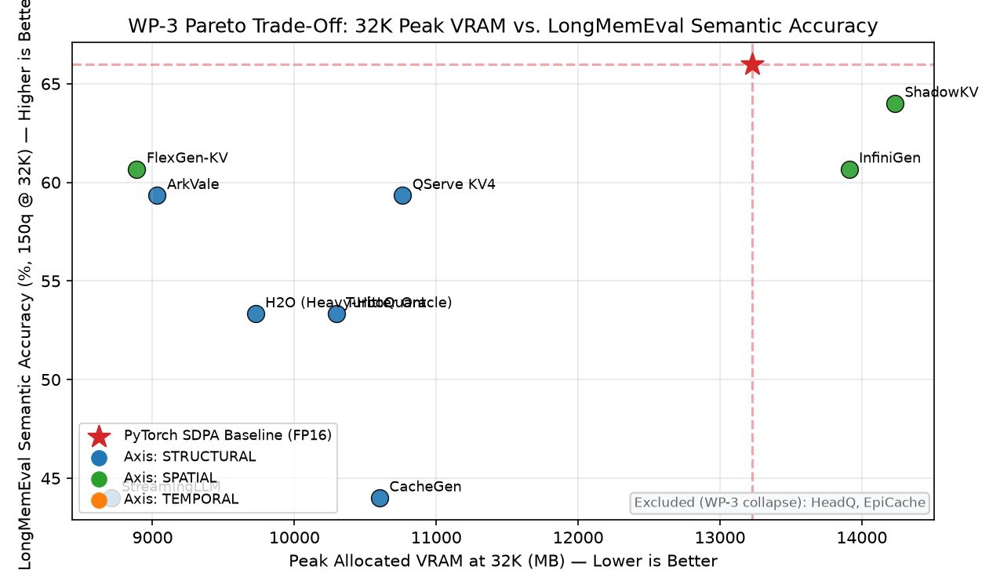
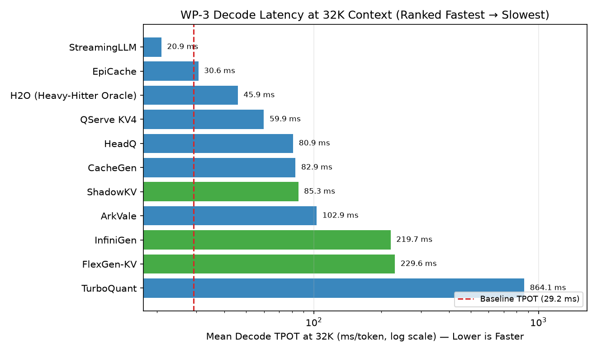
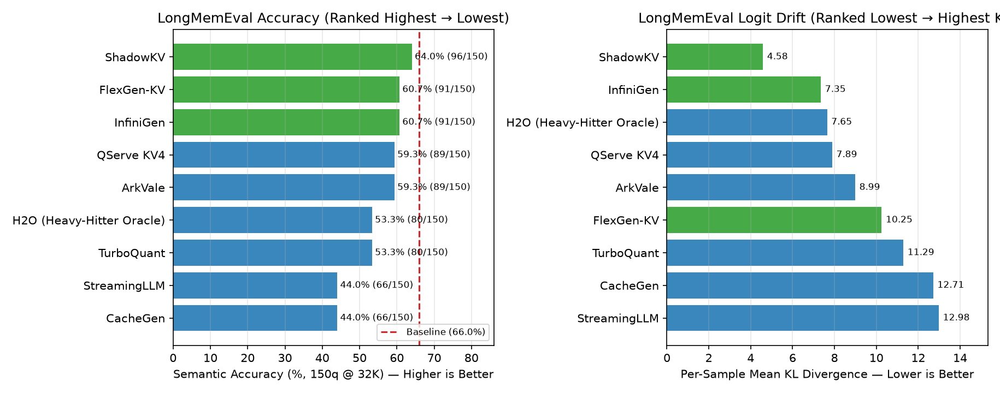

# WP-3 Candidate Exploration & Synthesis Report

**Model:** `Qwen/Qwen3-4B-Instruct-2507` (FP16/BF16 unmodified weights) | **Engine:** `PyTorch Native SDPA` (distinct from WP-2's vLLM V1 baseline) | **Hardware Cap:** `16.0 GiB` VRAM (`gpu4090`)

This executive report synthesizes empirical results across all 11 reproduced KV-cache optimization candidates. Note on theoretical vs. empirical VRAM: because unmodified FP16 model weights and runtime buffers occupy ~7.5 GiB fixed VRAM, a 4× KV-cache reduction translates to ~18–35% total process VRAM savings at 32K context. Fine-grained tables, per-capability breakdowns, and `matplotlib` figures live in [`docs/wp3_profiles/`](wp3_profiles/).

> [!NOTE]
> **LongMemEval Evaluation Protocol:** All 9 working techniques + Baseline were evaluated under the canonical LongMemEval harness (`ctx=32768` single-pass native length, **150** quantile-sampled official questions = 30/capability including all 30 official `_abs` unanswerables, Qwen chat template, `max_tokens=128` + multi-EOS stopping, per-sample KL alignment, and decoupled offline semantic grading). `HeadQ` (`0/99*`) and `EpiCache` (`10/99*`) suffered catastrophic collapse (`0%` NIAH) in initial screening and retain their screening collapse counts.

---

## 1. Cross-Technique Summary Matrix

| WP | Technique | Primary Axis | 32K VRAM (MB) | 32K TPOT (ms) | 32K Host RSS Δ (MB) | 32K Memcpy (B/tok) | PG-19 KL | LongMem KL | NIAH (2K / 4K) | LongMem Semantic | Regressions | Profile |
|:---:|---|:---:|---:|---:|---:|---:|---:|---:|:---:|:---:|---:|---|
| WP2 | **PyTorch SDPA Baseline** | — | **13225** | **29.2** | **1082** | **0** | — | — | — | **99/150 (66.0%)** | **0** | [`baseline_pytorch_16gb.json`](../results/baseline_pytorch_16gb.json) |
| WP3-1 | **StreamingLLM** | `STRUCTURAL` | 8712 | 20.9 | 1326 | 8266 | 6.88 | 12.98 | 100% / 40% | 66/150 (44.0%) | 37 | [Profile](wp3_profiles/streamingllm.md) |
| WP3-2 | **H2O (Heavy-Hitter Oracle)** | `STRUCTURAL` | 9725 | 45.9 | 6874 | 2005976 | 6.55 | 7.65 | 100% / 20% | 80/150 (53.3%) | 22 | [Profile](wp3_profiles/h2o.md) |
| WP3-3 | **TurboQuant** | `STRUCTURAL` | 10294 | 864.1 | 7529 | 13265 | 11.89 | 11.29 | 100% / 100% | 80/150 (53.3%) | 20 | [Profile](wp3_profiles/turboquant.md) |
| WP3-4 | **HeadQ** | `STRUCTURAL` | 10109 | 80.9 | 4656 | 8289 | 13.52 | 14.84 | 0% / 0% | 0/99* *(collapse)* | 25 | [Profile](wp3_profiles/headq.md) |
| WP3-5 | **QServe KV4** | `STRUCTURAL` | 10763 | 59.9 | 3629 | 8266 | 10.25 | 7.89 | 100% / 100% | 89/150 (59.3%) | 13 | [Profile](wp3_profiles/qserve_kv4.md) |
| WP3-6 | **FlexGen-KV** | `SPATIAL` | 8889 | 229.6 | 6565 | 1646964418 | 10.80 | 10.25 | 100% / 100% | 91/150 (60.7%) | 14 | [Profile](wp3_profiles/flexgen_kv.md) |
| WP3-7 | **ShadowKV** | `SPATIAL` | 14233 | 85.3 | 5325 | 67241955 | 5.32 | 4.58 | 100% / 100% | 96/150 (64.0%) | 3 | [Profile](wp3_profiles/shadowkv.md) |
| WP3-8 | **CacheGen** | `STRUCTURAL` | 10600 | 82.9 | 4536 | 935016151 | 12.87 | 12.71 | 40% / 80% | 66/150 (44.0%) | 36 | [Profile](wp3_profiles/cachegen.md) |
| WP3-9 | **InfiniGen** | `SPATIAL` | 13910 | 219.7 | 20491 | 1829885205 | 11.64 | 7.35 | 100% / 100% | 91/150 (60.7%) | 13 | [Profile](wp3_profiles/infinigen.md) |
| WP3-10 | **ArkVale** | `STRUCTURAL` | 9033 | 102.9 | 16614 | 1618383854 | 11.42 | 8.99 | 100% / 100% | 89/150 (59.3%) | 14 | [Profile](wp3_profiles/arkvale.md) |
| WP3-11 | **EpiCache** | `STRUCTURAL` | 8567 | 30.6 | 2846 | 442264 | 9.86 | 9.00 | 0% / 0% | 10/99* *(collapse)* | 17 | [Profile](wp3_profiles/epicache.md) |

---

## 2. Technique Spotlights (Mechanism & Prominent Upside)

### WP3-1: StreamingLLM (`STRUCTURAL`) — [Full Profile](wp3_profiles/streamingllm.md)
- **Mechanism:** StreamingLLM retains a small set of initial 'attention sink' tokens alongside a fixed-size rolling sliding window of the most recent tokens. When the sequence exceeds the combined budget, intermediate tokens between the sinks and the local window are evicted in FIFO order, bounding KV-cache memory to O(1) regardless of prompt length.
- **Prominent Upside:** **34.1% lower 32K VRAM** (8712 MB); **20.9 ms/tok** decode TPOT (1.39× baseline speed)
- **Primary Trade-Off:** NIAH drops to **100% @2K / 40% @4K**; LongMemEval drops to **66/150 (44.0%)** (37 regressions)

### WP3-2: H2O (Heavy-Hitter Oracle) (`STRUCTURAL`) — [Full Profile](wp3_profiles/h2o.md)
- **Mechanism:** H2O partitions the fixed KV budget between a recent local window and a 'heavy-hitter' pool selected by cumulative attention scores. At each step, tokens with the lowest accumulated attention (pooled across GQA heads) are evicted to keep high-impact context tokens in GPU memory.
- **Prominent Upside:** **26.5% lower 32K VRAM** (9725 MB)
- **Primary Trade-Off:** 32K decode TPOT is **1.57× slower** (45.9 ms/tok); NIAH drops to **100% @2K / 20% @4K**; LongMemEval drops to **80/150 (53.3%)** (22 regressions)

### WP3-3: TurboQuant (`STRUCTURAL`) — [Full Profile](wp3_profiles/turboquant.md)
- **Mechanism:** TurboQuant applies asymmetric low-bit quantization to Keys and Values, using a Walsh-Hadamard rotation to smooth outlier channels before quantization and a Quantized Johnson-Lindenstrauss (QJL) sketch on Values to preserve inner-product fidelity.
- **Prominent Upside:** **22.2% lower 32K VRAM** (10294 MB); **100% NIAH** exact-match retrieval (2K & 4K)
- **Primary Trade-Off:** 32K decode TPOT is **29.62× slower** (864.1 ms/tok); LongMemEval drops to **80/150 (53.3%)** (20 regressions)

### WP3-4: HeadQ (`STRUCTURAL`) — [Full Profile](wp3_profiles/headq.md)
- **Mechanism:** HeadQ compresses Keys aggressively down to 2 bits while storing Values at 4 bits, augmenting the quantized Keys with a low-rank PCA residual side-code to recover high-variance attention directions.
- **Prominent Upside:** **23.6% lower 32K VRAM** (10109 MB)
- **Primary Trade-Off:** 32K decode TPOT is **2.77× slower** (80.9 ms/tok); NIAH drops to **0% @2K / 0% @4K**; LongMemEval collapse (**0/99* **, excluded from full 150q sweep); high PG-19 KL (**13.52**)

### WP3-5: QServe KV4 (`STRUCTURAL`) — [Full Profile](wp3_profiles/qserve_kv4.md)
- **Mechanism:** QServe KV4 performs group-wise 4-bit symmetric/asymmetric KV-cache quantization paired with SmoothAttention, which migrates channel-wise outlier magnitudes from Keys into the Query projection scaling before quantizing.
- **Prominent Upside:** **18.6% lower 32K VRAM** (10763 MB); **100% NIAH** exact-match retrieval (2K & 4K); **89/150 (59.3%) LongMemEval** (13 regressions)
- **Primary Trade-Off:** 32K decode TPOT is **2.05× slower** (59.9 ms/tok)

### WP3-6: FlexGen-KV (`SPATIAL`) — [Full Profile](wp3_profiles/flexgen_kv.md)
- **Mechanism:** FlexGen-KV tiers the KV cache across GPU VRAM and host CPU RAM, keeping a bounded active budget on the GPU while offloading older KV blocks to CPU memory with group-wise quantization to reduce host-device PCIe transfer volume.
- **Prominent Upside:** **32.8% lower 32K VRAM** (8889 MB); **100% NIAH** exact-match retrieval (2K & 4K); **91/150 (60.7%) LongMemEval** (14 regressions)
- **Primary Trade-Off:** 32K decode TPOT is **7.87× slower** (229.6 ms/tok)

### WP3-7: ShadowKV (`SPATIAL`) — [Full Profile](wp3_profiles/shadowkv.md)
- **Mechanism:** ShadowKV keeps low-rank SVD-compressed Key representations and sparse outlier channels on the GPU for fast chunk-level relevance scoring, while offloading full-precision Values to CPU RAM and fetching only the top-k relevant chunks on demand during decode.
- **Prominent Upside:** **100% NIAH** exact-match retrieval (2K & 4K); **96/150 (64.0%) LongMemEval** (3 regressions); low LongMemEval KL (**4.58**)
- **Primary Trade-Off:** **+7.6% higher 32K VRAM** (14233 MB vs. 13225 MB baseline); 32K decode TPOT is **2.92× slower** (85.3 ms/tok)

### WP3-8: CacheGen (`STRUCTURAL`) — [Full Profile](wp3_profiles/cachegen.md)
- **Mechanism:** CacheGen encodes KV tensors using anchor-delta compression (storing periodic anchor tokens at higher precision and encoding intermediate tokens as deltas) combined with layer-tiered bit allocation across shallow, middle, and deep transformer layers.
- **Prominent Upside:** **19.8% lower 32K VRAM** (10600 MB)
- **Primary Trade-Off:** 32K decode TPOT is **2.84× slower** (82.9 ms/tok); NIAH drops to **40% @2K / 80% @4K**; LongMemEval drops to **66/150 (44.0%)** (36 regressions); high PG-19 KL (**12.87**)

### WP3-9: InfiniGen (`SPATIAL`) — [Full Profile](wp3_profiles/infinigen.md)
- **Mechanism:** InfiniGen speculatively prefetches important KV blocks from CPU memory one layer ahead by using low-rank key proxies and threshold-based importance prediction to overlap host-to-device transfers with layer computation.
- **Prominent Upside:** **100% NIAH** exact-match retrieval (2K & 4K); **91/150 (60.7%) LongMemEval** (13 regressions)
- **Primary Trade-Off:** **+5.2% higher 32K VRAM** (13910 MB vs. 13225 MB baseline); 32K decode TPOT is **7.53× slower** (219.7 ms/tok)

### WP3-10: ArkVale (`STRUCTURAL`) — [Full Profile](wp3_profiles/arkvale.md)
- **Mechanism:** ArkVale organizes the KV cache into fixed-size pages offloaded to CPU RAM and maintains Axis-Aligned Bounding Box (AABB) geometric digests on the GPU to recall and page-in only the relevant KV pages per query.
- **Prominent Upside:** **31.7% lower 32K VRAM** (9033 MB); **100% NIAH** exact-match retrieval (2K & 4K); **89/150 (59.3%) LongMemEval** (14 regressions)
- **Primary Trade-Off:** 32K decode TPOT is **3.53× slower** (102.9 ms/tok)

### WP3-11: EpiCache (`STRUCTURAL`) — [Full Profile](wp3_profiles/epicache.md)
- **Mechanism:** EpiCache clusters conversational/context history into episodic segments and allocates per-layer KV budgets according to layer sensitivity, pruning low-sensitivity tokens within each episode to fit a compact GPU budget.
- **Prominent Upside:** **35.2% lower 32K VRAM** (8567 MB); **30.6 ms/tok** decode TPOT (0.95× baseline speed)
- **Primary Trade-Off:** NIAH drops to **0% @2K / 0% @4K**; LongMemEval collapse (**10/99* **, excluded from full 150q sweep)

---

## 3. Pareto, Latency & LongMemEval Overview

---

## 4. Key Takeaways for WP-4 (3-Axis Co-Optimization)

1. **Lowest Memory & Fastest Decode Come from Structural Eviction, at the Cost of NIAH Recall:** `EpiCache` achieves the lowest 32K VRAM (**8567 MB**) and `StreamingLLM` achieves the fastest 32K decode (**20.9 ms/tok**), but both lose non-local needles at 4K.
2. **4-Bit KV Quantization Preserves Full-Context Recall Without Catastrophic Overhead:** `QServe KV4` preserves **100% NIAH** exact-match retrieval (2K & 4K) with **10763 MB** 32K VRAM and **59.9 ms/tok** TPOT (fastest among 100%-NIAH structural methods), establishing 4-bit group quantization as the safest *Structural* baseline for WP-4.
3. **Spatial Offloading Must Control PCIe & Auxiliary Buffer Overhead:** Offloading techniques (`FlexGen-KV`, `ArkVale`, `ShadowKV`, `InfiniGen`) preserve 100% NIAH at 2K/4K, but high PCIe transfer volume or auxiliary prefetch buffers can erode VRAM or TPOT gains if left uncoordinated.
