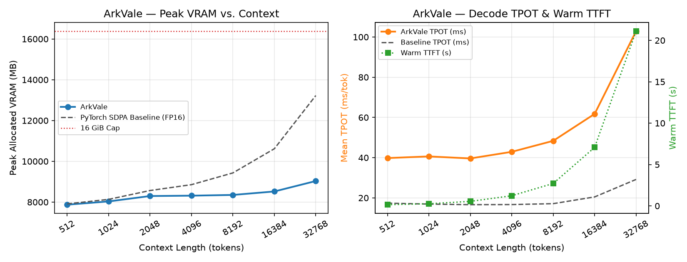
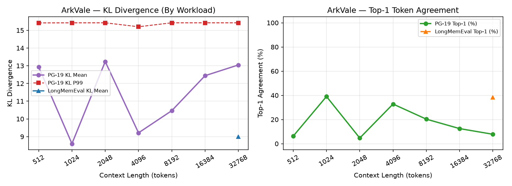
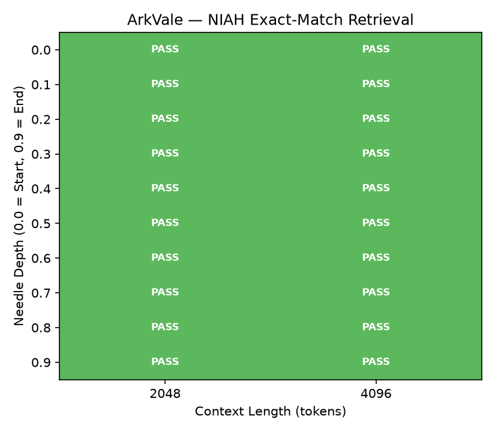
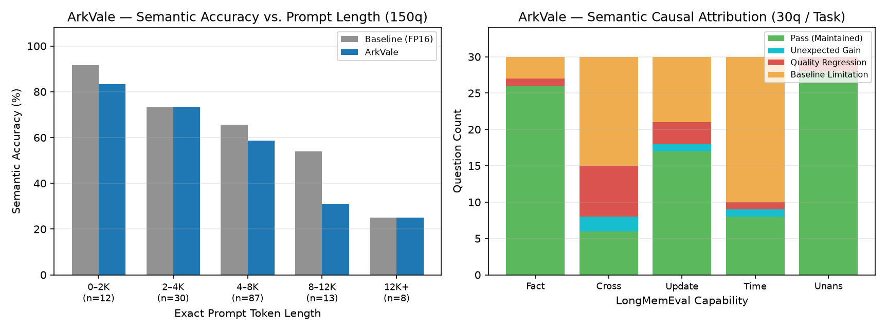

# WP3-10: ArkVale

**Primary Axis:** `STRUCTURAL` | **All Axes:** `STRUCTURAL, SPATIAL` | **Model:** `Qwen3-4B-Instruct-2507` (16.0 GiB Cap, PyTorch Native SDPA)

**Artifact Provenance (SHA-256):** `arkvale_hardware_pytorch_16gb.json`: `VERIFIED` (`ba4c2ed121e1…`) | `arkvale_longmem_pytorch_16gb.json`: `UPDATED (post-manifest re-run)` (`5bbd4fc9fce2…`) | `arkvale_niah_pytorch_16gb.json`: `VERIFIED` (`cc37c564cb5b…`)

---

## 1. What It Does & How (Brief)

ArkVale organizes the KV cache into fixed-size pages offloaded to CPU RAM and maintains Axis-Aligned Bounding Box (AABB) geometric digests on the GPU to recall and page-in only the relevant KV pages per query.

- **Evaluated Configuration:** `page_size=16`, `active_pages_budget=16`, `exempt_early_layers=2`, `block_size=16`

---

## 2. Empirical Results

### 2.1 Hardware Metric Sweep (512 → 32,768)

| Context | Status | Peak Alloc (MB) | Peak Reserved (MB) | Warm TTFT (s) | Cold TTFT (s) | TPOT Mean (ms) | TPOT P95 (ms) | Throughput (tok/s) | Host RSS Δ (MB) | Memcpy (B/tok) |
|---:|:---:|---:|---:|---:|---:|---:|---:|---:|---:|---:|
| 512 | SUCCESS | 7872.8 | 7888.0 | 0.147 | 0.000 | 39.80 | 39.80 | 25.13 | 2605.0 | 39299182.2 |
| 1024 | SUCCESS | 8032.3 | 8070.0 | 0.261 | 0.000 | 40.61 | 40.61 | 24.62 | 2916.5 | 45818094.2 |
| 2048 | SUCCESS | 8296.9 | 8386.0 | 0.547 | 0.000 | 39.61 | 39.61 | 25.25 | 3394.5 | 61155822.2 |
| 4096 | SUCCESS | 8314.9 | 8418.0 | 1.228 | 0.000 | 42.90 | 42.90 | 23.31 | 4703.7 | 98979822.2 |
| 8192 | SUCCESS | 8351.0 | 8378.0 | 2.708 | 0.000 | 48.36 | 48.36 | 20.68 | 6475.5 | 202785774.2 |
| 16384 | SUCCESS | 8520.8 | 8678.0 | 7.074 | 0.000 | 61.76 | 61.76 | 16.19 | 9810.8 | 523649006.2 |
| 32768 | SUCCESS | 9032.9 | 9238.0 | 21.116 | 0.000 | 102.92 | 102.92 | 9.72 | 16613.6 | 1618383854.2 |

### 2.2 KL Divergence & Logit Fidelity

#### PG-19 Hardware Sweep

| Context | KL Div Mean | KL Div P99 | Top-1 Agreement (%) |
|---:|---:|---:|---:|
| 512 | 12.9289 | 15.4197 | 6.25 |
| 1024 | 8.6010 | 15.4243 | 39.06 |
| 2048 | 13.2358 | 15.4249 | 4.69 |
| 4096 | 9.2134 | 15.2016 | 32.81 |
| 8192 | 10.4651 | 15.4249 | 20.31 |
| 16384 | 12.4399 | 15.4249 | 12.50 |
| 32768 | 13.0449 | 15.4249 | 7.81 |

#### LongMemEval Conversational Sweep

| Context Tier | KL Div Mean | KL Div P99 | Top-1 Agreement (%) |
|---:|---:|---:|---:|
| 32768 | 8.9879 | 15.4249 | 38.36 |

### 2.3 Needle-In-A-Haystack (NIAH) 2D Sweep

| Depth \ Context | 2048 | 4096 |
|---:|:---:|:---:|
| 0.0 | PASS | PASS |
| 0.1 | PASS | PASS |
| 0.2 | PASS | PASS |
| 0.3 | PASS | PASS |
| 0.4 | PASS | PASS |
| 0.5 | PASS | PASS |
| 0.6 | PASS | PASS |
| 0.7 | PASS | PASS |
| 0.8 | PASS | PASS |
| 0.9 | PASS | PASS |
| **Overall Accuracy** | **100.0%** | **100.0%** |

### 2.4 LongMemEval & Post-Hoc Diagnostics

**LongMemEval v2 (150 Quantile-Sampled Official Questions, Single-Pass Native Length @ 32K, Chat Template, `max_tokens=128`, Semantic Graded):**

| Context Ceiling | Semantic Acc | Pass / Total | Quality Regressions | Baseline Limitations | Unexpected Gains | EOS Clean Stops | Mean Retention | Eff. Bitwidth |
|---:|---:|:---:|---:|---:|---:|:---:|---:|---:|
| 32768 | **59.3%** | **89/150** | 14 | 47 | 4 | 146/150 | 0.11 | 1.76 |

#### 5-Capability Semantic Accuracy Breakdown (30 Official Questions / Capability)

| Capability | Samples | Technique Acc | Baseline Acc | Δ vs. Baseline |
|---|---:|---:|---:|---:|
| `fact_recall` | 30 | 86.7% | 90.0% | -3.3% |
| `cross_session_reasoning` | 30 | 26.7% | 43.3% | -16.7% |
| `information_update` | 30 | 60.0% | 66.7% | -6.7% |
| `relative_timeframe` | 30 | 30.0% | 30.0% | +0.0% |
| `unanswerable_refusal` | 30 | 93.3% | 100.0% | -6.7% |

---

## 3. Diagnostic Analysis & Metric-Backed Pros/Cons

### Why It Is Better or Worse Than Baseline

Tested with page_size=16, active_pages_budget=16, and exempt_early_layers=2. While GPU-resident pages stay tightly bounded, post-hoc retention inspection sees only the active GPU-resident pages unless offloaded pages are recalled.

On the 2D NIAH diagnostic sweep, exact-match retrieval across depths 0.0–0.9 is **2048: 100%, 4096: 100%**.

On LongMemEval v2 (150 quantile-sampled official questions at native length up to 32K, chat-templated, `max_tokens=128`, semantically graded), ArkVale achieves **89/150 (59.3%)** vs. baseline **99/150 (66.0%)**, with **14** quality regressions and mean KV retention ratio **0.11**.

### Pros

- Reduces peak allocated VRAM at 32K by **31.7%** (9033 MB vs. 13225 MB baseline).
- Achieves **100% NIAH exact-match retrieval** across all depths (0.0–0.9) at both 2,048 and 4,096 context lengths.
- Preserves strong LongMemEval v2 semantic accuracy (**89/150 = 59.3%** vs. 99/150 = 66.0% baseline; **14** quality regressions).

### Cons

- Decode latency at 32K is **3.53x slower** than baseline (**102.9 ms/tok** vs. 29.2 ms/tok).
- High host-device transfer volume at 32K (**1618383854 B/tok**, Host RSS Δ = **16614 MB**).
- Elevated PG-19 logit divergence (mean KL = **11.42**, Top-1 = **17.6%**).
