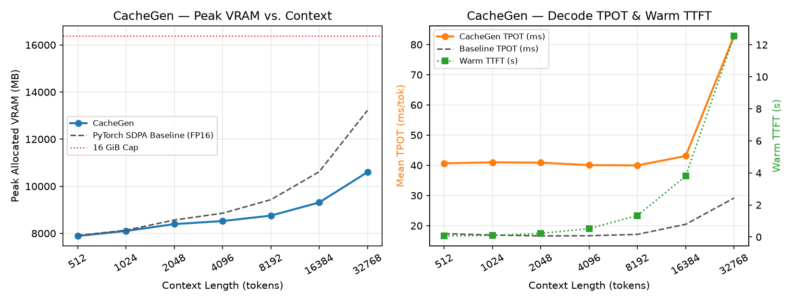
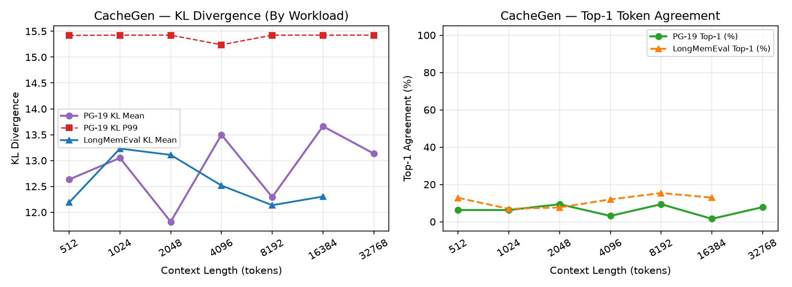
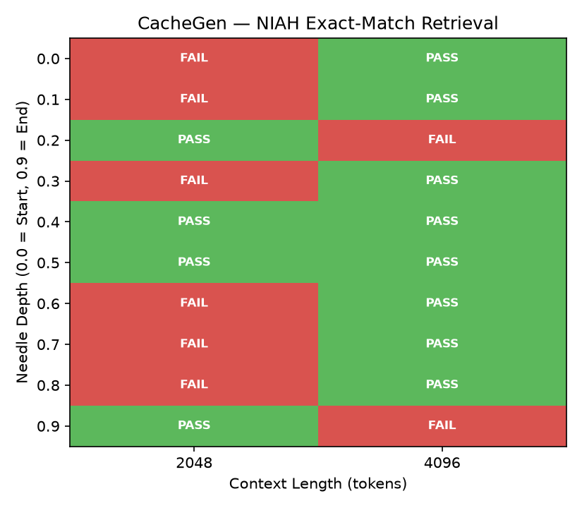
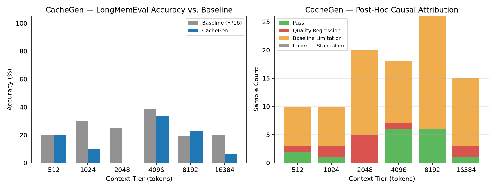

# WP3-8: CacheGen

**Primary Axis:** `STRUCTURAL` | **All Axes:** `STRUCTURAL, SPATIAL` | **Model:** `Qwen3-4B-Instruct-2507` (16.0 GiB Cap, PyTorch Native SDPA)

**Artifact Provenance (SHA-256):** `cachegen_hardware_pytorch_16gb.json`: `UPDATED (post-manifest re-run)` (`acc433feceac…`) | `cachegen_longmem_pytorch_16gb.json`: `UPDATED (post-manifest re-run)` (`d555aa946243…`) | `cachegen_niah_pytorch_16gb.json`: `UPDATED (post-manifest re-run)` (`67b12f9ee081…`)

---

## 1. What It Does & How (Brief)

CacheGen encodes KV tensors using anchor-delta compression (storing periodic anchor tokens at higher precision and encoding intermediate tokens as deltas) combined with layer-tiered bit allocation across shallow, middle, and deep transformer layers.

- **Evaluated Configuration:** `anchor_group_size=10`, `shallow_bits=8`, `mid_bits=4`, `deep_bits=2`, `block_size=16`

---

## 2. Empirical Results

### 2.1 Hardware Metric Sweep (512 → 32,768)

| Context | Status | Peak Alloc (MB) | Peak Reserved (MB) | Warm TTFT (s) | Cold TTFT (s) | TPOT Mean (ms) | TPOT P95 (ms) | Throughput (tok/s) | Host RSS Δ (MB) | Memcpy (B/tok) |
|---:|:---:|---:|---:|---:|---:|---:|---:|---:|---:|---:|
| 512 | SUCCESS | 7891.8 | 7906.0 | 0.064 | 0.000 | 40.66 | 40.66 | 24.59 | 3127.7 | 253.5 |
| 1024 | SUCCESS | 8101.6 | 8112.0 | 0.095 | 0.000 | 40.99 | 40.99 | 24.40 | 3136.8 | 1888125.5 |
| 2048 | SUCCESS | 8394.0 | 8436.0 | 0.223 | 0.000 | 40.88 | 40.88 | 24.46 | 3198.5 | 5659266.6 |
| 4096 | SUCCESS | 8523.5 | 8726.0 | 0.524 | 0.000 | 40.07 | 40.07 | 24.96 | 3255.3 | 11318405.9 |
| 8192 | SUCCESS | 8753.6 | 9026.0 | 1.338 | 0.000 | 39.97 | 39.97 | 25.02 | 3438.2 | 52794513.2 |
| 16384 | SUCCESS | 9311.6 | 9646.0 | 3.803 | 0.000 | 43.09 | 43.09 | 23.21 | 3826.7 | 226229415.7 |
| 32768 | SUCCESS | 10600.2 | 10966.0 | 12.555 | 0.000 | 82.87 | 82.87 | 12.07 | 4535.8 | 935016150.9 |

### 2.2 KL Divergence & Logit Fidelity

#### PG-19 Hardware Sweep

| Context | KL Div Mean | KL Div P99 | Top-1 Agreement (%) |
|---:|---:|---:|---:|
| 512 | 12.6342 | 15.4199 | 6.25 |
| 1024 | 13.0502 | 15.4249 | 6.25 |
| 2048 | 11.8169 | 15.4248 | 9.38 |
| 4096 | 13.4983 | 15.2393 | 3.12 |
| 8192 | 12.2941 | 15.4249 | 9.38 |
| 16384 | 13.6631 | 15.4249 | 1.56 |
| 32768 | 13.1353 | 15.4249 | 7.81 |

#### LongMemEval Conversational Sweep

| Context Tier | KL Div Mean | KL Div P99 | Top-1 Agreement (%) |
|---:|---:|---:|---:|
| 512 | 12.1891 | 15.4249 | 12.81 |
| 1024 | 13.2311 | 15.4249 | 6.88 |
| 2048 | 13.1094 | 15.4249 | 7.66 |
| 4096 | 12.5166 | 15.4249 | 11.98 |
| 8192 | 12.1365 | 15.4249 | 15.38 |
| 16384 | 12.3040 | 15.4249 | 12.92 |

### 2.3 Needle-In-A-Haystack (NIAH) 2D Sweep

| Depth \ Context | 2048 | 4096 |
|---:|:---:|:---:|
| 0.0 | FAIL | PASS |
| 0.1 | FAIL | PASS |
| 0.2 | PASS | FAIL |
| 0.3 | FAIL | PASS |
| 0.4 | PASS | PASS |
| 0.5 | PASS | PASS |
| 0.6 | FAIL | PASS |
| 0.7 | FAIL | PASS |
| 0.8 | FAIL | PASS |
| 0.9 | PASS | FAIL |
| **Overall Accuracy** | **40.0%** | **80.0%** |

### 2.4 LongMemEval & Post-Hoc Diagnostics

| Context Tier | Acc | F1 | Pass / Total | Quality Regressions | Baseline Limitations | Mean Retention | Eff. Bitwidth |
|---:|---:|---:|:---:|---:|---:|---:|---:|
| 512 | 0.20 | 0.06 | 2/10 | 1 | 7 | 1.00 | 16.00 |
| 1024 | 0.10 | 0.04 | 1/10 | 2 | 7 | 1.00 | 16.00 |
| 2048 | 0.00 | 0.06 | 0/20 | 5 | 15 | 1.00 | 16.00 |
| 4096 | 0.33 | 0.09 | 6/18 | 1 | 11 | 1.00 | 16.00 |
| 8192 | 0.23 | 0.08 | 6/26 | 0 | 20 | 1.00 | 16.00 |
| 16384 | 0.07 | 0.07 | 1/15 | 2 | 12 | 1.00 | 16.00 |

#### 5-Capability Accuracy Breakdown (Sample-Weighted Across Context Tiers)

| Capability | Samples | Technique Acc | Baseline Acc | Δ vs. Baseline |
|---|---:|---:|---:|---:|
| `fact_recall` | 22 | 9.1% | 50.0% | -40.9% |
| `cross_session_reasoning` | 16 | 0.0% | 6.2% | -6.2% |
| `information_update` | 20 | 45.0% | 45.0% | +0.0% |
| `relative_timeframe` | 19 | 21.1% | 21.1% | +0.0% |
| `unanswerable_refusal` | 22 | 4.5% | 0.0% | +4.5% |

---

## 3. Diagnostic Analysis & Metric-Backed Pros/Cons

### Why It Is Better or Worse Than Baseline

Tested with anchor_group_size=10, shallow_bits=8, mid_bits=4, and deep_bits=2. Aggressive 2-bit quantization in deep layers reduces memory footprint but can degrade fine-grained multi-hop and exact-match retrieval.

On the 2D NIAH diagnostic sweep, exact-match retrieval across depths 0.0–0.9 is **2048: 40%, 4096: 80%**.

On LongMemEval (99 inspected samples across 512–16,384 tokens), CacheGen scores **16/99** with **11** quality regressions relative to the uncompressed baseline (25/99) and a mean token retention ratio of **1.00**.

### Pros

- Reduces peak allocated VRAM at 32K by **19.8%** (10600 MB vs. 13225 MB baseline).

### Cons

- Decode latency at 32K is **2.84x slower** than baseline (**82.9 ms/tok** vs. 29.2 ms/tok).
- High host-device transfer volume at 32K (**935016151 B/tok**, Host RSS Δ = **4536 MB**).
- Elevated PG-19 logit divergence (mean KL = **12.87**, Top-1 = **6.2%**).
- NIAH retrieval drops to **80%** at 4,096 tokens (failing at depths `[0.2, 0.9]`), confirming loss of early/non-local needle tokens.
- Trails baseline LongMemEval pass count (**16/99** vs. 25/99 baseline) with **11** quality regressions (mean KV retention ratio = **1.00**).
