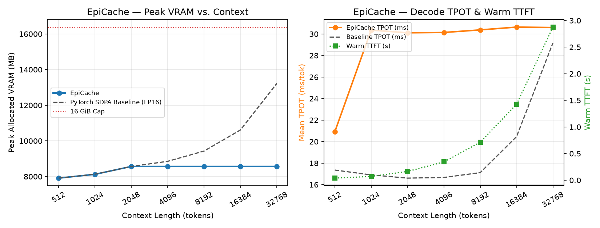
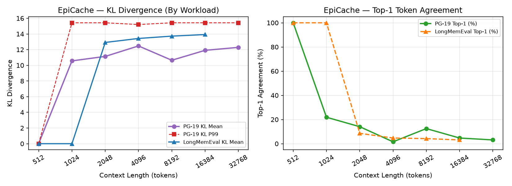
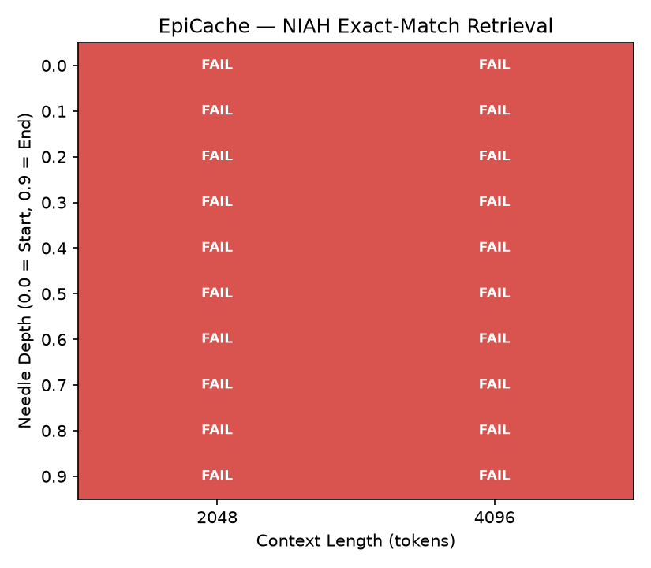
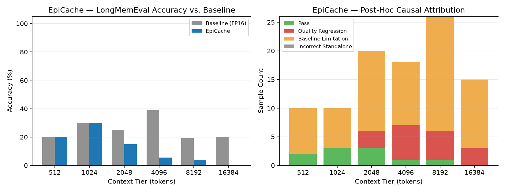

# WP3-11: EpiCache

**Primary Axis:** `STRUCTURAL` | **All Axes:** `STRUCTURAL, SPATIAL` | **Model:** `Qwen3-4B-Instruct-2507` (16.0 GiB Cap, PyTorch Native SDPA)

**Artifact Provenance (SHA-256):** `epicache_hardware_pytorch_16gb.json`: `VERIFIED` (`f2e7550025d3…`) | `epicache_longmem_pytorch_16gb.json`: `VERIFIED` (`0b7b5b00cd9d…`) | `epicache_niah_pytorch_16gb.json`: `VERIFIED` (`fc945c375ed7…`)

---

## 1. What It Does & How (Brief)

EpiCache clusters conversational/context history into episodic segments and allocates per-layer KV budgets according to layer sensitivity, pruning low-sensitivity tokens within each episode to fit a compact GPU budget.

- **Evaluated Configuration:** `num_episodes=4`, `episode_budget_tokens=1024`, `layer_sensitivity_alpha=2.0`, `block_size=16`

---

## 2. Empirical Results

### 2.1 Hardware Metric Sweep (512 → 32,768)

| Context | Status | Peak Alloc (MB) | Peak Reserved (MB) | Warm TTFT (s) | Cold TTFT (s) | TPOT Mean (ms) | TPOT P95 (ms) | Throughput (tok/s) | Host RSS Δ (MB) | Memcpy (B/tok) |
|---:|:---:|---:|---:|---:|---:|---:|---:|---:|---:|---:|
| 512 | SUCCESS | 7911.7 | 7998.0 | 0.039 | 0.000 | 20.91 | 20.91 | 47.81 | 1985.1 | 201.8 |
| 1024 | SUCCESS | 8126.2 | 8164.0 | 0.070 | 0.000 | 30.36 | 30.36 | 32.94 | 2328.0 | 291200.8 |
| 2048 | SUCCESS | 8566.9 | 8624.0 | 0.164 | 0.000 | 30.11 | 30.11 | 33.21 | 2381.1 | 296073.8 |
| 4096 | SUCCESS | 8566.9 | 8924.0 | 0.343 | 0.000 | 30.14 | 30.14 | 33.18 | 2419.2 | 305819.8 |
| 8192 | SUCCESS | 8567.0 | 8924.0 | 0.713 | 0.000 | 30.38 | 30.38 | 32.91 | 2501.4 | 325311.8 |
| 16384 | SUCCESS | 8567.0 | 8924.0 | 1.428 | 0.000 | 30.64 | 30.64 | 32.64 | 2666.0 | 364295.8 |
| 32768 | SUCCESS | 8567.1 | 8924.0 | 2.877 | 0.000 | 30.60 | 30.60 | 32.68 | 2845.7 | 442263.8 |

### 2.2 KL Divergence & Logit Fidelity

#### PG-19 Hardware Sweep

| Context | KL Div Mean | KL Div P99 | Top-1 Agreement (%) |
|---:|---:|---:|---:|
| 512 | 0.0000 | 0.0000 | 100.00 |
| 1024 | 10.5659 | 15.4247 | 21.88 |
| 2048 | 11.1357 | 15.4249 | 14.06 |
| 4096 | 12.4710 | 15.2016 | 1.56 |
| 8192 | 10.6454 | 15.4249 | 12.50 |
| 16384 | 11.9114 | 15.4249 | 4.69 |
| 32768 | 12.2879 | 15.4249 | 3.12 |

#### LongMemEval Conversational Sweep

| Context Tier | KL Div Mean | KL Div P99 | Top-1 Agreement (%) |
|---:|---:|---:|---:|
| 512 | 0.0000 | 0.0000 | 100.00 |
| 1024 | 0.0000 | 0.0000 | 100.00 |
| 2048 | 12.9167 | 15.4249 | 8.59 |
| 4096 | 13.4255 | 15.4249 | 4.69 |
| 8192 | 13.7235 | 15.4249 | 4.21 |
| 16384 | 13.9244 | 15.4249 | 3.12 |

### 2.3 Needle-In-A-Haystack (NIAH) 2D Sweep

| Depth \ Context | 2048 | 4096 |
|---:|:---:|:---:|
| 0.0 | FAIL | FAIL |
| 0.1 | FAIL | FAIL |
| 0.2 | FAIL | FAIL |
| 0.3 | FAIL | FAIL |
| 0.4 | FAIL | FAIL |
| 0.5 | FAIL | FAIL |
| 0.6 | FAIL | FAIL |
| 0.7 | FAIL | FAIL |
| 0.8 | FAIL | FAIL |
| 0.9 | FAIL | FAIL |
| **Overall Accuracy** | **0.0%** | **0.0%** |

### 2.4 LongMemEval & Post-Hoc Diagnostics

| Context Tier | Acc | F1 | Pass / Total | Quality Regressions | Baseline Limitations | Mean Retention | Eff. Bitwidth |
|---:|---:|---:|:---:|---:|---:|---:|---:|
| 512 | 0.20 | 0.12 | 2/10 | 0 | 8 | 1.00 | 16.00 |
| 1024 | 0.30 | 0.13 | 3/10 | 0 | 7 | 1.00 | 16.00 |
| 2048 | 0.15 | 0.11 | 3/20 | 3 | 14 | 0.60 | 9.63 |
| 4096 | 0.06 | 0.04 | 1/18 | 6 | 11 | 0.30 | 4.83 |
| 8192 | 0.04 | 0.02 | 1/26 | 5 | 20 | 0.15 | 2.42 |
| 16384 | 0.00 | 0.03 | 0/15 | 3 | 12 | 0.08 | 1.21 |

#### 5-Capability Accuracy Breakdown (Sample-Weighted Across Context Tiers)

| Capability | Samples | Technique Acc | Baseline Acc | Δ vs. Baseline |
|---|---:|---:|---:|---:|
| `fact_recall` | 22 | 31.8% | 50.0% | -18.2% |
| `cross_session_reasoning` | 16 | 0.0% | 6.2% | -6.2% |
| `information_update` | 20 | 10.0% | 45.0% | -35.0% |
| `relative_timeframe` | 19 | 0.0% | 21.1% | -21.1% |
| `unanswerable_refusal` | 22 | 4.5% | 0.0% | +4.5% |

---

## 3. Diagnostic Analysis & Metric-Backed Pros/Cons

### Why It Is Better or Worse Than Baseline

Tested with num_episodes=4, episode_budget_tokens=1,024, and layer_sensitivity_alpha=2.0. Because episodic clustering operates independently of exact-string needle tokens, isolated facts or passcodes can be pruned when budgets are tight.

On the 2D NIAH diagnostic sweep, exact-match retrieval across depths 0.0–0.9 is **2048: 0%, 4096: 0%**.

On LongMemEval (99 inspected samples across 512–16,384 tokens), EpiCache scores **10/99** with **17** quality regressions relative to the uncompressed baseline (25/99) and a mean token retention ratio of **0.52**.

### Pros

- Reduces peak allocated VRAM at 32K by **35.2%** (8567 MB vs. 13225 MB baseline).
- Decode latency at 32K is faster or at parity with baseline (**30.6 ms/tok** vs. 29.2 ms/tok, 0.95x speed).

### Cons

- High host-device transfer volume at 32K (**442264 B/tok**, Host RSS Δ = **2846 MB**).
- Elevated PG-19 logit divergence (mean KL = **9.86**, Top-1 = **22.5%**).
- NIAH retrieval drops to **0%** at 4,096 tokens (failing at depths `[0.0, 0.1, 0.2, 0.3, 0.4, 0.5, 0.6, 0.7, 0.8, 0.9]`), confirming loss of early/non-local needle tokens.
- Trails baseline LongMemEval pass count (**10/99** vs. 25/99 baseline) with **17** quality regressions (mean KV retention ratio = **0.52**).
