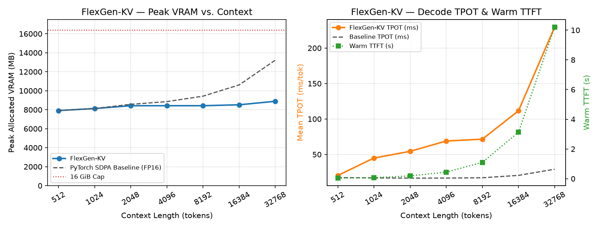
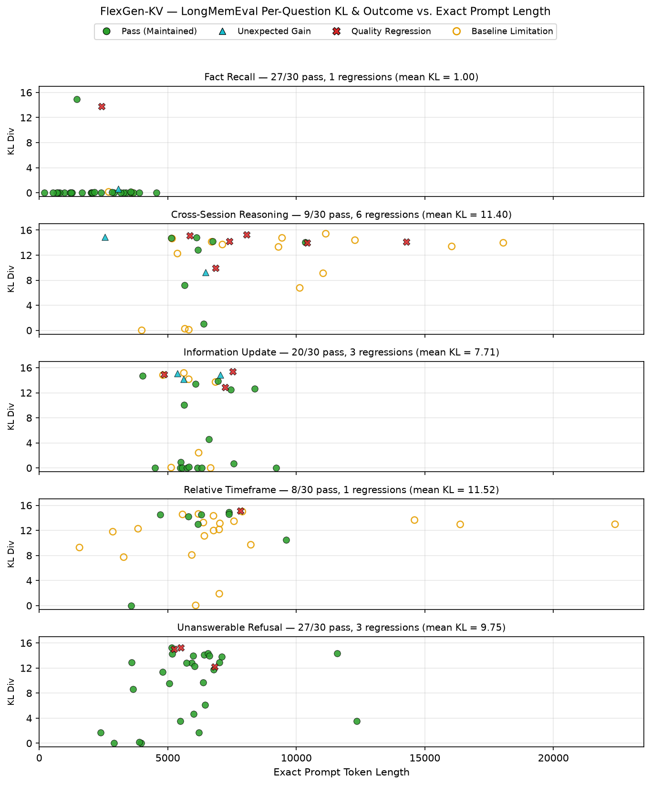

# WP3-6: FlexGen-KV

**Primary Axis:** `SPATIAL` | **All Axes:** `SPATIAL, STRUCTURAL` | **Model:** `Qwen3-4B-Instruct-2507` (16.0 GiB Cap, PyTorch Native SDPA)

**Artifact Provenance (SHA-256):** `flexgen_kv_hardware_pytorch_16gb.json`: `VERIFIED` (`bd79f1dd9965…`) | `flexgen_kv_longmem_pytorch_16gb.json`: `UPDATED (post-manifest re-run)` (`513a8a4e922c…`) | `flexgen_kv_niah_pytorch_16gb.json`: `VERIFIED` (`6ff0ae38d44b…`)

---

## 1. What It Does & How (Brief)

FlexGen-KV tiers the KV cache across GPU VRAM and host CPU RAM, keeping a bounded active budget on the GPU while offloading older KV blocks to CPU memory with group-wise quantization to reduce host-device PCIe transfer volume.

- **Evaluated Configuration:** `gpu_cache_tokens=1024`, `cpu_cache_tokens=32768`, `block_size=16`, `quantize_kv=True`, `group_size=64`, `cpu_delegation=False`, `swap_space_gb=4`

---

## 2. Empirical Results

### 2.1 Hardware Metric Sweep (512 → 32,768)

| Context | Status | Peak Alloc (MB) | Peak Reserved (MB) | Warm TTFT (s) | Cold TTFT (s) | TPOT Mean (ms) | TPOT P95 (ms) | Throughput (tok/s) | Host RSS Δ (MB) | Memcpy (B/tok) |
|---:|:---:|---:|---:|---:|---:|---:|---:|---:|---:|---:|
| 512 | SUCCESS | 7911.7 | 7998.0 | 0.039 | 0.000 | 20.33 | 20.33 | 49.18 | 1981.8 | 201.8 |
| 1024 | SUCCESS | 8126.5 | 8164.0 | 0.070 | 0.000 | 44.94 | 44.94 | 22.25 | 3447.6 | 1347521.8 |
| 2048 | SUCCESS | 8422.9 | 8464.0 | 0.188 | 0.000 | 54.37 | 54.37 | 18.39 | 3500.6 | 44478657.8 |
| 4096 | SUCCESS | 8422.9 | 8766.0 | 0.440 | 0.000 | 68.92 | 68.92 | 14.51 | 3709.9 | 132731585.8 |
| 8192 | SUCCESS | 8423.0 | 8766.0 | 1.099 | 0.000 | 71.55 | 71.55 | 13.98 | 4123.0 | 317200065.8 |
| 16384 | SUCCESS | 8520.8 | 8786.0 | 3.126 | 0.000 | 111.51 | 111.51 | 8.97 | 4925.4 | 717987521.8 |
| 32768 | SUCCESS | 8888.9 | 8986.0 | 10.205 | 0.000 | 229.57 | 229.57 | 4.36 | 6564.6 | 1646964417.8 |

### 2.2 KL Divergence & Logit Fidelity

#### PG-19 Hardware Sweep

| Context | KL Div Mean | KL Div P99 | Top-1 Agreement (%) |
|---:|---:|---:|---:|
| 512 | 0.0000 | 0.0000 | 100.00 |
| 1024 | 10.8596 | 15.4247 | 23.44 |
| 2048 | 12.2849 | 15.4235 | 7.81 |
| 4096 | 13.2523 | 15.2318 | 3.12 |
| 8192 | 14.1239 | 15.4249 | 0.00 |
| 16384 | 13.1506 | 15.4249 | 6.25 |
| 32768 | 11.9269 | 15.4249 | 10.94 |

#### LongMemEval Conversational Sweep

| Context Tier | KL Div Mean | KL Div P99 | Top-1 Agreement (%) |
|---:|---:|---:|---:|
| 32768 | 10.2504 | 15.4249 | 29.99 |

### 2.3 Needle-In-A-Haystack (NIAH) 2D Sweep

| Depth \ Context | 2048 | 4096 |
|---:|:---:|:---:|
| 0.0 | PASS | PASS |
| 0.1 | PASS | PASS |
| 0.2 | PASS | PASS |
| 0.3 | PASS | PASS |
| 0.4 | PASS | PASS |
| 0.5 | PASS | PASS |
| 0.6 | PASS | PASS |
| 0.7 | PASS | PASS |
| 0.8 | PASS | PASS |
| 0.9 | PASS | PASS |
| **Overall Accuracy** | **100.0%** | **100.0%** |

### 2.4 LongMemEval & Post-Hoc Diagnostics

**LongMemEval (150 Quantile-Sampled Official Questions, Single-Pass Native Length @ 32K, Chat Template, `max_tokens=128`, Semantic Graded):**

| Context Ceiling | Semantic Acc | Pass / Total | Quality Regressions | Baseline Limitations | Unexpected Gains | EOS Clean Stops | Mean Retention | Eff. Bitwidth |
|---:|---:|:---:|---:|---:|---:|:---:|---:|---:|
| 32768 | **60.7%** | **91/150** | 14 | 45 | 6 | 146/150 | 1.00 | 16.00 |

#### 5-Capability Semantic Accuracy Breakdown (30 Official Questions / Capability)

| Capability | Samples | Technique Acc | Baseline Acc | Δ vs. Baseline |
|---|---:|---:|---:|---:|
| `fact_recall` | 30 | 90.0% | 90.0% | +0.0% |
| `cross_session_reasoning` | 30 | 30.0% | 43.3% | -13.3% |
| `information_update` | 30 | 66.7% | 66.7% | +0.0% |
| `relative_timeframe` | 30 | 26.7% | 30.0% | -3.3% |
| `unanswerable_refusal` | 30 | 90.0% | 100.0% | -10.0% |

---

## 3. Diagnostic Analysis & Metric-Backed Pros/Cons

### Why It Is Better or Worse Than Baseline

Tested with gpu_cache_tokens=1,024, cpu_cache_tokens=32,768, group_size=64, and quantize_kv=True. All context tokens remain accessible via CPU tiering, making PCIe bandwidth and host-to-device staging the primary latency bottleneck at long contexts.

On the 2D NIAH diagnostic sweep, exact-match retrieval across depths 0.0–0.9 is **2048: 100%, 4096: 100%**.

On LongMemEval (150 quantile-sampled official questions at native length up to 32K, chat-templated, `max_tokens=128`, semantically graded), FlexGen-KV achieves **91/150 (60.7%)** vs. baseline **99/150 (66.0%)**, with **14** quality regressions and mean KV retention ratio **1.00**.

### Pros

- Reduces peak allocated VRAM at 32K by **32.8%** (8889 MB vs. 13225 MB baseline).
- Achieves **100% NIAH exact-match retrieval** across all depths (0.0–0.9) at both 2,048 and 4,096 context lengths.
- Preserves strong LongMemEval semantic accuracy (**91/150 = 60.7%** vs. 99/150 = 66.0% baseline; **14** quality regressions).

### Cons

- Decode latency at 32K is **7.87x slower** than baseline (**229.6 ms/tok** vs. 29.2 ms/tok).
- High host-device transfer volume at 32K (**1646964418 B/tok**, Host RSS Δ = **6565 MB**).
- Elevated PG-19 logit divergence (mean KL = **10.80**, Top-1 = **21.7%**).
