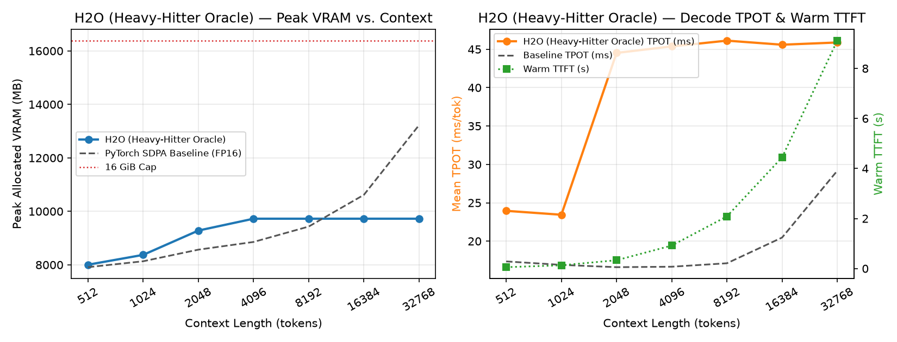
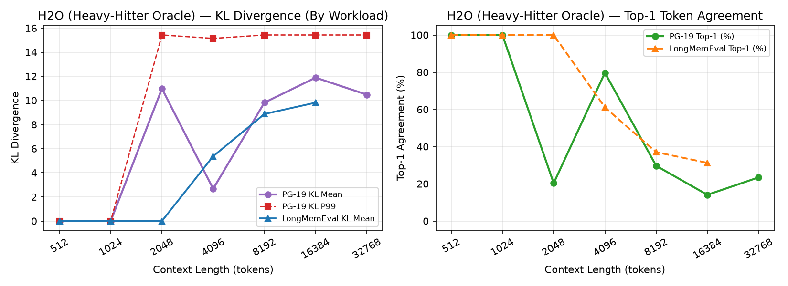
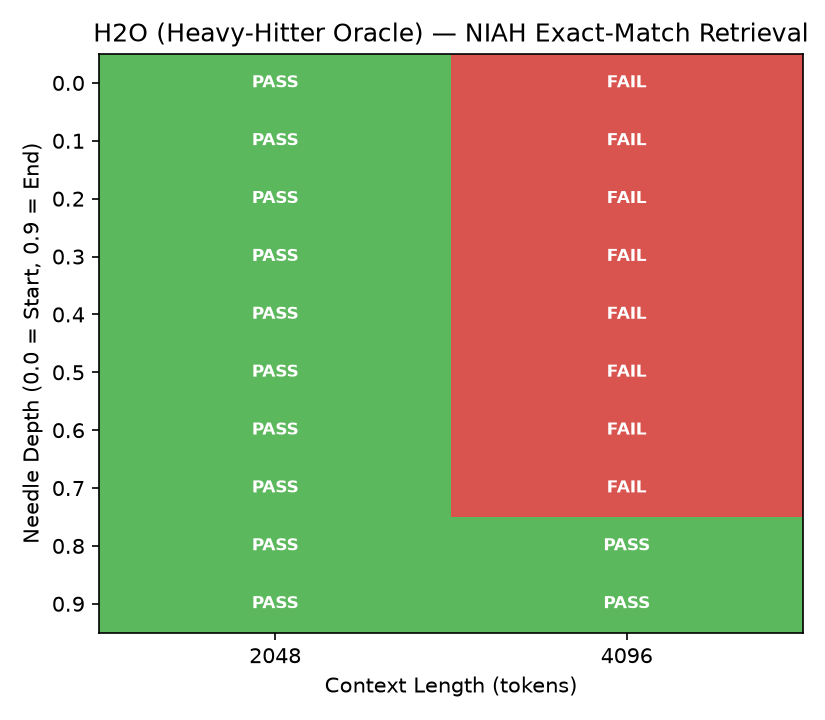
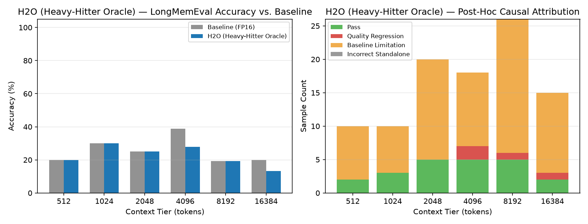

# WP3-2: H2O (Heavy-Hitter Oracle)

**Primary Axis:** `STRUCTURAL` | **All Axes:** `STRUCTURAL` | **Model:** `Qwen3-4B-Instruct-2507` (16.0 GiB Cap, PyTorch Native SDPA)

**Artifact Provenance (SHA-256):** `h2o_hardware_pytorch_16gb.json`: `VERIFIED` (`6de1820c969f…`) | `h2o_longmem_pytorch_16gb.json`: `VERIFIED` (`845af0f55840…`) | `h2o_niah_pytorch_16gb.json`: `VERIFIED` (`1c7c735501be…`)

---

## 1. What It Does & How (Brief)

H2O partitions the fixed KV budget between a recent local window and a 'heavy-hitter' pool selected by cumulative attention scores. At each step, tokens with the lowest accumulated attention (pooled across GQA heads) are evicted to keep high-impact context tokens in GPU memory.

- **Evaluated Configuration:** `heavy_hitter_tokens=1024`, `recent_window_tokens=1024`, `block_size=16`, `effective_cache_tokens=2048`, `effective_cache_blocks=128`

---

## 2. Empirical Results

### 2.1 Hardware Metric Sweep (512 → 32,768)

| Context | Status | Peak Alloc (MB) | Peak Reserved (MB) | Warm TTFT (s) | Cold TTFT (s) | TPOT Mean (ms) | TPOT P95 (ms) | Throughput (tok/s) | Host RSS Δ (MB) | Memcpy (B/tok) |
|---:|:---:|---:|---:|---:|---:|---:|---:|---:|---:|---:|
| 512 | SUCCESS | 8003.9 | 8118.0 | 0.054 | 0.000 | 23.95 | 23.95 | 41.75 | 4039.0 | 201.8 |
| 1024 | SUCCESS | 8372.1 | 8466.0 | 0.130 | 0.000 | 23.44 | 23.44 | 42.66 | 4040.5 | 329.8 |
| 2048 | SUCCESS | 9281.2 | 9348.0 | 0.332 | 0.000 | 44.52 | 44.52 | 22.46 | 4740.5 | 1307095.5 |
| 4096 | SUCCESS | 9724.4 | 9988.0 | 0.918 | 0.000 | 45.37 | 45.37 | 22.04 | 4884.5 | 1353687.5 |
| 8192 | SUCCESS | 9724.5 | 9988.0 | 2.085 | 0.000 | 46.12 | 46.12 | 21.68 | 5176.7 | 1446871.5 |
| 16384 | SUCCESS | 9724.5 | 9990.0 | 4.443 | 0.000 | 45.59 | 45.59 | 21.93 | 5747.9 | 1633239.5 |
| 32768 | SUCCESS | 9724.6 | 9990.0 | 9.110 | 0.000 | 45.88 | 45.88 | 21.80 | 6873.7 | 2005975.5 |

### 2.2 KL Divergence & Logit Fidelity

#### PG-19 Hardware Sweep

| Context | KL Div Mean | KL Div P99 | Top-1 Agreement (%) |
|---:|---:|---:|---:|
| 512 | 0.0000 | 0.0000 | 100.00 |
| 1024 | 0.0000 | 0.0000 | 100.00 |
| 2048 | 10.9782 | 15.4249 | 20.31 |
| 4096 | 2.6678 | 15.1387 | 79.69 |
| 8192 | 9.8161 | 15.4249 | 29.69 |
| 16384 | 11.8890 | 15.4249 | 14.06 |
| 32768 | 10.4767 | 15.4249 | 23.44 |

#### LongMemEval Conversational Sweep

| Context Tier | KL Div Mean | KL Div P99 | Top-1 Agreement (%) |
|---:|---:|---:|---:|
| 512 | 0.0000 | 0.0000 | 100.00 |
| 1024 | 0.0000 | 0.0000 | 100.00 |
| 2048 | 0.0000 | 0.0000 | 100.00 |
| 4096 | 5.3681 | 15.4249 | 61.11 |
| 8192 | 8.8717 | 15.4249 | 37.02 |
| 16384 | 9.8144 | 15.4249 | 31.25 |

### 2.3 Needle-In-A-Haystack (NIAH) 2D Sweep

| Depth \ Context | 2048 | 4096 |
|---:|:---:|:---:|
| 0.0 | PASS | FAIL |
| 0.1 | PASS | FAIL |
| 0.2 | PASS | FAIL |
| 0.3 | PASS | FAIL |
| 0.4 | PASS | FAIL |
| 0.5 | PASS | FAIL |
| 0.6 | PASS | FAIL |
| 0.7 | PASS | FAIL |
| 0.8 | PASS | PASS |
| 0.9 | PASS | PASS |
| **Overall Accuracy** | **100.0%** | **20.0%** |

### 2.4 LongMemEval & Post-Hoc Diagnostics

| Context Tier | Acc | F1 | Pass / Total | Quality Regressions | Baseline Limitations | Mean Retention | Eff. Bitwidth |
|---:|---:|---:|:---:|---:|---:|---:|---:|
| 512 | 0.20 | 0.12 | 2/10 | 0 | 8 | 1.00 | 16.00 |
| 1024 | 0.30 | 0.13 | 3/10 | 0 | 7 | 1.00 | 16.00 |
| 2048 | 0.25 | 0.13 | 5/20 | 0 | 15 | 1.00 | 16.00 |
| 4096 | 0.28 | 0.08 | 5/18 | 2 | 11 | 0.60 | 9.59 |
| 8192 | 0.19 | 0.08 | 5/26 | 1 | 20 | 0.30 | 4.80 |
| 16384 | 0.13 | 0.09 | 2/15 | 1 | 12 | 0.15 | 2.39 |

#### 5-Capability Accuracy Breakdown (Sample-Weighted Across Context Tiers)

| Capability | Samples | Technique Acc | Baseline Acc | Δ vs. Baseline |
|---|---:|---:|---:|---:|
| `fact_recall` | 22 | 45.5% | 50.0% | -4.5% |
| `cross_session_reasoning` | 16 | 0.0% | 6.2% | -6.2% |
| `information_update` | 20 | 40.0% | 45.0% | -5.0% |
| `relative_timeframe` | 19 | 21.1% | 21.1% | -0.0% |
| `unanswerable_refusal` | 22 | 0.0% | 0.0% | +0.0% |

---

## 3. Diagnostic Analysis & Metric-Backed Pros/Cons

### Why It Is Better or Worse Than Baseline

Tested with 1,024 heavy-hitter tokens + 1,024 recent window tokens (2,048 total budget). Computing cumulative attention scores adds per-step scoring overhead during decode and relies on past attention magnitude as a proxy for future token utility.

On the 2D NIAH diagnostic sweep, exact-match retrieval across depths 0.0–0.9 is **2048: 100%, 4096: 20%**.

On LongMemEval (99 inspected samples across 512–16,384 tokens), H2O (Heavy-Hitter Oracle) scores **22/99** with **4** quality regressions relative to the uncompressed baseline (25/99) and a mean token retention ratio of **0.67**.

### Pros

- Reduces peak allocated VRAM at 32K by **26.5%** (9725 MB vs. 13225 MB baseline).

### Cons

- Decode latency at 32K is **1.57x slower** than baseline (**45.9 ms/tok** vs. 29.2 ms/tok).
- High host-device transfer volume at 32K (**2005976 B/tok**, Host RSS Δ = **6874 MB**).
- Elevated PG-19 logit divergence (mean KL = **6.55**, Top-1 = **52.5%**).
- NIAH retrieval drops to **20%** at 4,096 tokens (failing at depths `[0.0, 0.1, 0.2, 0.3, 0.4, 0.5, 0.6, 0.7]`), confirming loss of early/non-local needle tokens.
- Trails baseline LongMemEval pass count (**22/99** vs. 25/99 baseline) with **4** quality regressions (mean KV retention ratio = **0.67**).
