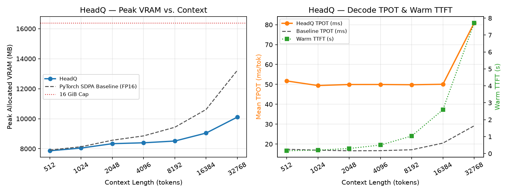
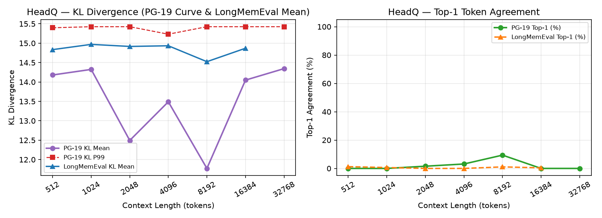
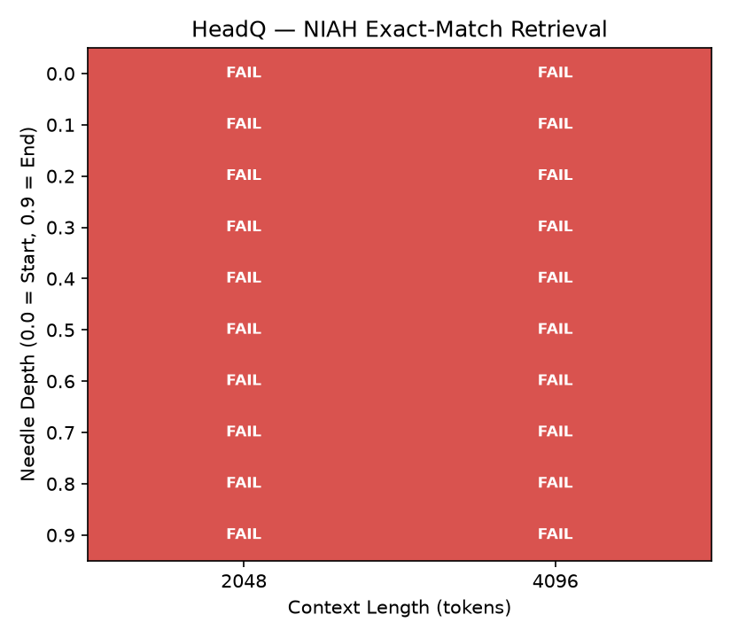
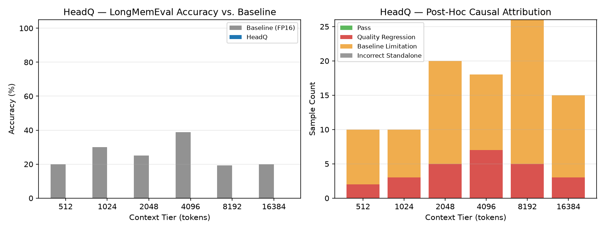

# WP3-4: HeadQ

**Primary Axis:** `STRUCTURAL` | **All Axes:** `STRUCTURAL` | **Model:** `Qwen3-4B-Instruct-2507` (16.0 GiB Cap, PyTorch Native SDPA)

**Artifact Provenance (SHA-256):** `headq_hardware_pytorch_16gb.json`: `VERIFIED` (`8dc8e382da4d…`) | `headq_longmem_pytorch_16gb.json`: `VERIFIED` (`7f8276616601…`) | `headq_niah_pytorch_16gb.json`: `VERIFIED` (`33c8f7aead57…`)

---

## 1. What It Does & How (Brief)

HeadQ compresses Keys aggressively down to 2 bits while storing Values at 4 bits, augmenting the quantized Keys with a low-rank PCA residual side-code to recover high-variance attention directions.

- **Evaluated Configuration:** `key_bits=2`, `val_bits=4`, `pca_rank=4`, `sidecode_bits=4`, `block_size=16`

---

## 2. Empirical Results

### 2.1 Hardware Metric Sweep (512 → 32,768)

| Context | Status | Peak Alloc (MB) | Peak Reserved (MB) | Warm TTFT (s) | Cold TTFT (s) | TPOT Mean (ms) | TPOT P95 (ms) | Throughput (tok/s) | Host RSS Δ (MB) | Memcpy (B/tok) |
|---:|:---:|---:|---:|---:|---:|---:|---:|---:|---:|---:|
| 512 | SUCCESS | 7863.5 | 7882.0 | 0.163 | 0.000 | 51.73 | 51.73 | 19.33 | 3631.0 | 225.3 |
| 1024 | SUCCESS | 8045.2 | 8064.0 | 0.204 | 0.000 | 49.41 | 49.41 | 20.24 | 3627.1 | 353.3 |
| 2048 | SUCCESS | 8337.5 | 8366.0 | 0.297 | 0.000 | 49.93 | 49.93 | 20.03 | 3677.5 | 609.3 |
| 4096 | SUCCESS | 8396.0 | 8666.0 | 0.501 | 0.000 | 49.94 | 49.94 | 20.02 | 3755.4 | 1121.3 |
| 8192 | SUCCESS | 8513.0 | 8906.0 | 1.036 | 0.000 | 49.81 | 49.81 | 20.08 | 3905.3 | 2145.3 |
| 16384 | SUCCESS | 9043.7 | 9118.0 | 2.591 | 0.000 | 50.06 | 50.06 | 19.98 | 4235.7 | 4193.3 |
| 32768 | SUCCESS | 10108.8 | 10254.0 | 7.717 | 0.000 | 80.89 | 80.89 | 12.36 | 4655.6 | 8289.3 |

### 2.2 KL Divergence & Logit Fidelity

#### PG-19 Hardware Sweep

| Context | KL Div Mean | KL Div P99 | Top-1 Agreement (%) |
|---:|---:|---:|---:|
| 512 | 14.1805 | 15.3975 | 0.00 |
| 1024 | 14.3242 | 15.4249 | 0.00 |
| 2048 | 12.4934 | 15.4249 | 1.56 |
| 4096 | 13.4899 | 15.2318 | 3.12 |
| 8192 | 11.7722 | 15.4249 | 9.38 |
| 16384 | 14.0483 | 15.4248 | 0.00 |
| 32768 | 14.3445 | 15.4249 | 0.00 |

#### LongMemEval Conversational Sweep

| Context Tier | KL Div Mean | KL Div P99 | Top-1 Agreement (%) |
|---:|---:|---:|---:|
| 512 | 14.8342 | 15.4249 | 1.25 |
| 1024 | 14.9696 | 15.4249 | 0.63 |
| 2048 | 14.9161 | 15.4249 | 0.00 |
| 4096 | 14.9336 | 15.4249 | 0.00 |
| 8192 | 14.5238 | 15.4249 | 1.08 |
| 16384 | 14.8696 | 15.4249 | 0.42 |

### 2.3 Needle-In-A-Haystack (NIAH) 2D Sweep

| Depth \ Context | 2048 | 4096 |
|---:|:---:|:---:|
| 0.0 | FAIL | FAIL |
| 0.1 | FAIL | FAIL |
| 0.2 | FAIL | FAIL |
| 0.3 | FAIL | FAIL |
| 0.4 | FAIL | FAIL |
| 0.5 | FAIL | FAIL |
| 0.6 | FAIL | FAIL |
| 0.7 | FAIL | FAIL |
| 0.8 | FAIL | FAIL |
| 0.9 | FAIL | FAIL |
| **Overall Accuracy** | **0.0%** | **0.0%** |

### 2.4 LongMemEval & Post-Hoc Diagnostics

| Context Tier | Acc | F1 | Pass / Total | Quality Regressions | Baseline Limitations | Mean Retention | Eff. Bitwidth |
|---:|---:|---:|:---:|---:|---:|---:|---:|
| 512 | 0.00 | 0.01 | 0/10 | 2 | 8 | 1.00 | 3.25 |
| 1024 | 0.00 | 0.00 | 0/10 | 3 | 7 | 1.00 | 3.25 |
| 2048 | 0.00 | 0.00 | 0/20 | 5 | 15 | 1.00 | 3.25 |
| 4096 | 0.00 | 0.00 | 0/18 | 7 | 11 | 1.00 | 3.25 |
| 8192 | 0.00 | 0.01 | 0/26 | 5 | 21 | 1.00 | 3.25 |
| 16384 | 0.00 | 0.00 | 0/15 | 3 | 12 | 1.00 | 3.25 |

#### 5-Capability Accuracy Breakdown (Legacy WP-3 Substring Evaluation)

| Capability | Samples | Technique Acc | Baseline Acc | Δ vs. Baseline |
|---|---:|---:|---:|---:|
| `fact_recall` | 22 | 0.0% | 50.0% | -50.0% |
| `cross_session_reasoning` | 16 | 0.0% | 6.2% | -6.2% |
| `information_update` | 20 | 0.0% | 45.0% | -45.0% |
| `relative_timeframe` | 19 | 0.0% | 21.1% | -21.1% |
| `unanswerable_refusal` | 22 | 0.0% | 0.0% | +0.0% |

---

## 3. Diagnostic Analysis & Metric-Backed Pros/Cons

### Why It Is Better or Worse Than Baseline

Tested with key_bits=2, val_bits=4, pca_rank=4, and sidecode_bits=4. At 2-bit key precision, even small quantization scale mismatches or uncalibrated residual projections can severely distort Q·K^T attention logits.

On the 2D NIAH diagnostic sweep, exact-match retrieval across depths 0.0–0.9 is **2048: 0%, 4096: 0%**.

On legacy WP-3 LongMemEval (99 raw substring evaluations across 512–16,384 tokens), HeadQ recorded **0/99** (**25** regressions vs. 25/99 legacy baseline; mean retention ratio = **1.00**). *Excluded from LongMemEval v2 due to catastrophic implementation collapse (0% NIAH).*

### Pros

- Reduces peak allocated VRAM at 32K by **23.6%** (10109 MB vs. 13225 MB baseline).

### Cons

- Decode latency at 32K is **2.77x slower** than baseline (**80.9 ms/tok** vs. 29.2 ms/tok).
- Elevated PG-19 logit divergence (mean KL = **13.52**, Top-1 = **2.0%**).
- NIAH retrieval drops to **0%** at 4,096 tokens (failing at depths `[0.0, 0.1, 0.2, 0.3, 0.4, 0.5, 0.6, 0.7, 0.8, 0.9]`), confirming loss of early/non-local needle tokens.
- Severe WP-3 LongMemEval collapse (**0/99** vs. 25/99 legacy baseline; **25** quality regressions, excluded from LongMemEval v2).
