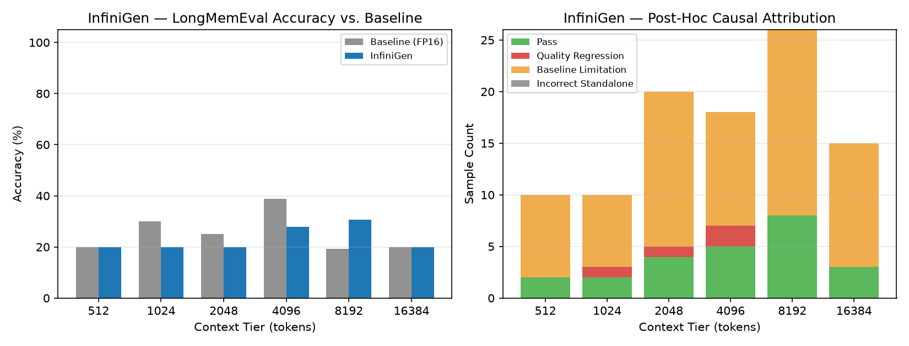

# WP3-9: InfiniGen

**Primary Axis:** `SPATIAL` | **All Axes:** `SPATIAL, TEMPORAL, STRUCTURAL` | **Model:** `Qwen3-4B-Instruct-2507` (16.0 GiB Cap, PyTorch Native SDPA)

**Artifact Provenance (SHA-256):** `infinigen_hardware_pytorch_16gb.json`: `VERIFIED` (`85ad425a18e7…`) | `infinigen_longmem_pytorch_16gb.json`: `VERIFIED` (`c3d9ece137f4…`) | `infinigen_niah_pytorch_16gb.json`: `VERIFIED` (`3edd0b98a4cc…`)

---

## 1. What It Does & How (Brief)

InfiniGen speculatively prefetches important KV blocks from CPU memory one layer ahead by using low-rank key proxies and threshold-based importance prediction to overlap host-to-device transfers with layer computation.

- **Evaluated Configuration:** `k_proxy_ratio=0.3`, `alpha_threshold=4.0`, `block_size=16`, `max_budget_ratio=0.35`, `swap_space_gb=4`

---

## 2. Empirical Results

### 2.1 Hardware Metric Sweep (512 → 32,768)

| Context | Status | Peak Alloc (MB) | Peak Reserved (MB) | Warm TTFT (s) | Cold TTFT (s) | TPOT Mean (ms) | TPOT P95 (ms) | Throughput (tok/s) | Host RSS Δ (MB) | Memcpy (B/tok) |
|---:|:---:|---:|---:|---:|---:|---:|---:|---:|---:|---:|
| 512 | SUCCESS | 7947.1 | 7958.0 | 0.071 | 0.000 | 45.05 | 45.05 | 22.20 | 2122.6 | 29696601.2 |
| 1024 | SUCCESS | 8170.0 | 8302.0 | 0.109 | 0.000 | 61.64 | 61.64 | 16.22 | 2202.1 | 55804006.9 |
| 2048 | SUCCESS | 8610.8 | 8740.0 | 0.228 | 0.000 | 64.66 | 64.66 | 15.47 | 2786.2 | 107520416.0 |
| 4096 | SUCCESS | 8941.6 | 9320.0 | 0.516 | 0.000 | 86.60 | 86.60 | 11.55 | 3953.7 | 187541319.2 |
| 8192 | SUCCESS | 9603.1 | 10200.0 | 1.344 | 0.000 | 111.55 | 111.55 | 8.96 | 6309.9 | 324091471.4 |
| 16384 | SUCCESS | 10959.9 | 11774.0 | 4.070 | 0.000 | 161.79 | 161.79 | 6.18 | 11049.3 | 710706859.1 |
| 32768 | SUCCESS | 13910.0 | 15474.0 | 15.372 | 0.000 | 219.68 | 219.68 | 4.55 | 20490.6 | 1829885205.2 |

### 2.2 KL Divergence & Logit Fidelity

#### PG-19 Hardware Sweep

| Context | KL Div Mean | KL Div P99 | Top-1 Agreement (%) |
|---:|---:|---:|---:|
| 512 | 12.7462 | 15.4200 | 9.38 |
| 1024 | 8.5429 | 15.4243 | 37.50 |
| 2048 | 13.3156 | 15.4249 | 3.12 |
| 4096 | 12.5069 | 15.2393 | 7.81 |
| 8192 | 9.8666 | 15.4249 | 25.00 |
| 16384 | 10.9649 | 15.4249 | 18.75 |
| 32768 | 13.5198 | 15.4249 | 4.69 |

#### LongMemEval Conversational Sweep

| Context Tier | KL Div Mean | KL Div P99 | Top-1 Agreement (%) |
|---:|---:|---:|---:|
| 512 | 6.4060 | 15.4249 | 54.37 |
| 1024 | 6.1251 | 15.4249 | 54.37 |
| 2048 | 6.7887 | 15.4249 | 51.56 |
| 4096 | 7.4502 | 15.4249 | 46.70 |
| 8192 | 7.1101 | 15.4249 | 48.44 |
| 16384 | 4.9029 | 15.4249 | 63.33 |

### 2.3 Needle-In-A-Haystack (NIAH) 2D Sweep

| Depth \ Context | 2048 | 4096 |
|---:|:---:|:---:|
| 0.0 | PASS | PASS |
| 0.1 | PASS | PASS |
| 0.2 | PASS | PASS |
| 0.3 | PASS | PASS |
| 0.4 | PASS | PASS |
| 0.5 | PASS | PASS |
| 0.6 | PASS | PASS |
| 0.7 | PASS | PASS |
| 0.8 | PASS | PASS |
| 0.9 | PASS | PASS |
| **Overall Accuracy** | **100.0%** | **100.0%** |

### 2.4 LongMemEval & Post-Hoc Diagnostics

| Context Tier | Acc | F1 | Pass / Total | Quality Regressions | Baseline Limitations | Mean Retention | Eff. Bitwidth |
|---:|---:|---:|:---:|---:|---:|---:|---:|
| 512 | 0.20 | 0.11 | 2/10 | 0 | 8 | 1.00 | 16.00 |
| 1024 | 0.20 | 0.11 | 2/10 | 1 | 7 | 1.00 | 16.00 |
| 2048 | 0.20 | 0.13 | 4/20 | 1 | 15 | 1.00 | 16.00 |
| 4096 | 0.28 | 0.07 | 5/18 | 2 | 11 | 1.00 | 16.00 |
| 8192 | 0.31 | 0.08 | 8/26 | 0 | 18 | 1.00 | 16.00 |
| 16384 | 0.20 | 0.10 | 3/15 | 0 | 12 | 1.00 | 16.00 |

#### 5-Capability Accuracy Breakdown (Sample-Weighted Across Context Tiers)

| Capability | Samples | Technique Acc | Baseline Acc | Δ vs. Baseline |
|---|---:|---:|---:|---:|
| `fact_recall` | 22 | 36.4% | 50.0% | -13.6% |
| `cross_session_reasoning` | 16 | 6.2% | 6.2% | +0.0% |
| `information_update` | 20 | 50.0% | 45.0% | +5.0% |
| `relative_timeframe` | 19 | 26.3% | 21.1% | +5.3% |
| `unanswerable_refusal` | 22 | 0.0% | 0.0% | +0.0% |

---

## 3. Diagnostic Analysis & Metric-Backed Pros/Cons

### Why It Is Better or Worse Than Baseline

Tested with k_proxy_ratio=0.3, alpha_threshold=4.0, and max_budget_ratio=0.35. Maintaining proxy projections and speculative prefetch buffers alongside CPU swap introduces substantial auxiliary GPU memory and control-plane overhead.

On the 2D NIAH diagnostic sweep, exact-match retrieval across depths 0.0–0.9 is **2048: 100%, 4096: 100%**.

On LongMemEval (99 inspected samples across 512–16,384 tokens), InfiniGen scores **24/99** with **4** quality regressions relative to the uncompressed baseline (25/99) and a mean token retention ratio of **1.00**.

### Pros

- Achieves **100% NIAH exact-match retrieval** across all depths (0.0–0.9) at both 2,048 and 4,096 context lengths.

### Cons

- Increases peak allocated VRAM at 32K by **+5.2%** (13910 MB vs. 13225 MB baseline) due to auxiliary metadata/prefetch buffers.
- Decode latency at 32K is **7.53x slower** than baseline (**219.7 ms/tok** vs. 29.2 ms/tok).
- High host-device transfer volume at 32K (**1829885205 B/tok**, Host RSS Δ = **20491 MB**).
- Elevated PG-19 logit divergence (mean KL = **11.64**, Top-1 = **15.2%**).
- Trails baseline LongMemEval pass count (**24/99** vs. 25/99 baseline) with **4** quality regressions (mean KV retention ratio = **1.00**).
