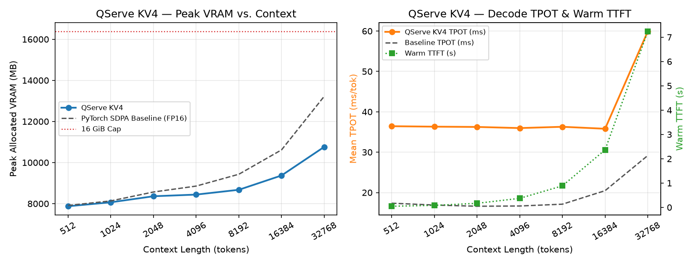
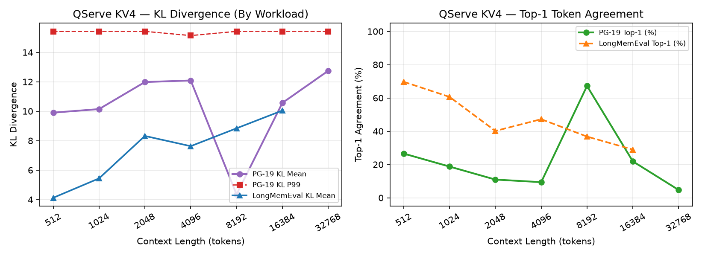
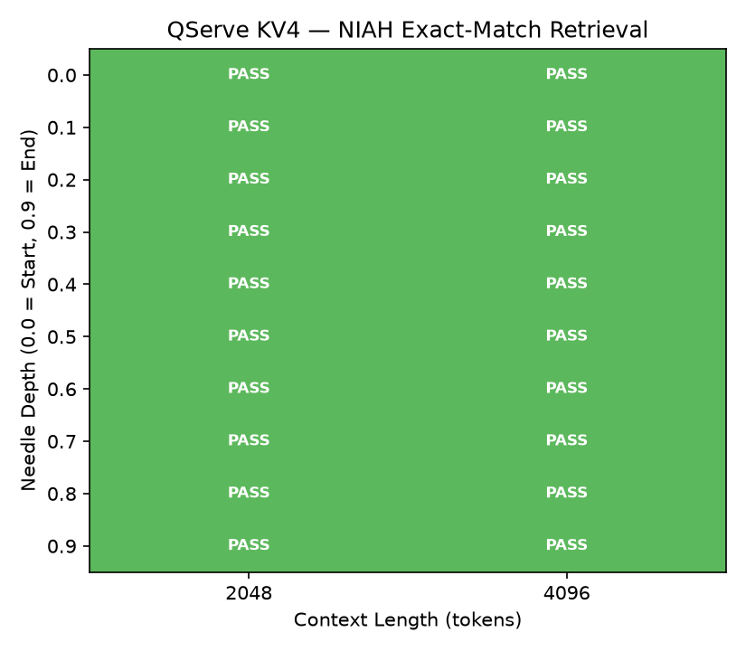
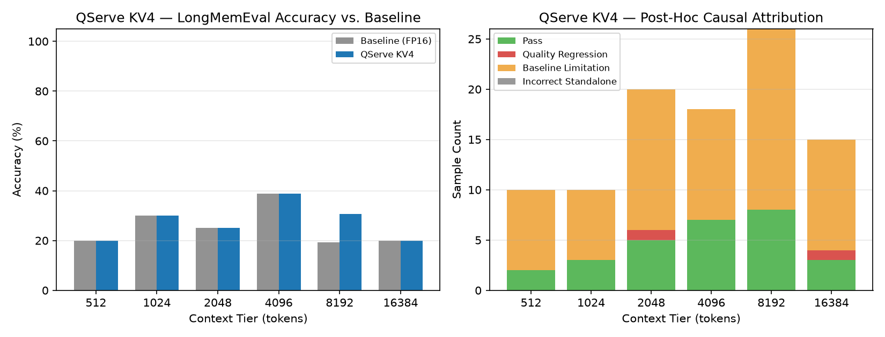

# WP3-5: QServe KV4

**Primary Axis:** `STRUCTURAL` | **All Axes:** `STRUCTURAL` | **Model:** `Qwen3-4B-Instruct-2507` (16.0 GiB Cap, PyTorch Native SDPA)

**Artifact Provenance (SHA-256):** `qserve_kv4_hardware_pytorch_16gb.json`: `VERIFIED` (`8f1d2a35aa6e…`) | `qserve_kv4_longmem_pytorch_16gb.json`: `VERIFIED` (`ea1f7f63e45d…`) | `qserve_kv4_niah_pytorch_16gb.json`: `VERIFIED` (`6400f386d866…`)

---

## 1. What It Does & How (Brief)

QServe KV4 performs group-wise 4-bit symmetric/asymmetric KV-cache quantization paired with SmoothAttention, which migrates channel-wise outlier magnitudes from Keys into the Query projection scaling before quantizing.

- **Evaluated Configuration:** `kv_cache_bits=4`, `group_size=32`, `smooth_attention_alpha=0.5`, `block_size=16`

---

## 2. Empirical Results

### 2.1 Hardware Metric Sweep (512 → 32,768)

| Context | Status | Peak Alloc (MB) | Peak Reserved (MB) | Warm TTFT (s) | Cold TTFT (s) | TPOT Mean (ms) | TPOT P95 (ms) | Throughput (tok/s) | Host RSS Δ (MB) | Memcpy (B/tok) |
|---:|:---:|---:|---:|---:|---:|---:|---:|---:|---:|---:|
| 512 | SUCCESS | 7873.6 | 7890.0 | 0.046 | 0.000 | 36.43 | 36.43 | 27.45 | 2791.3 | 201.8 |
| 1024 | SUCCESS | 8065.5 | 8088.0 | 0.082 | 0.000 | 36.32 | 36.32 | 27.53 | 2791.7 | 329.8 |
| 2048 | SUCCESS | 8360.0 | 8390.0 | 0.166 | 0.000 | 36.25 | 36.25 | 27.59 | 2835.8 | 585.8 |
| 4096 | SUCCESS | 8441.0 | 8690.0 | 0.371 | 0.000 | 35.97 | 35.97 | 27.80 | 2894.6 | 1097.8 |
| 8192 | SUCCESS | 8674.6 | 9010.0 | 0.885 | 0.000 | 36.29 | 36.29 | 27.56 | 3004.3 | 2121.8 |
| 16384 | SUCCESS | 9370.6 | 9550.0 | 2.366 | 0.000 | 35.80 | 35.80 | 27.93 | 3205.7 | 4169.8 |
| 32768 | SUCCESS | 10762.7 | 11030.0 | 7.239 | 0.000 | 59.92 | 59.92 | 16.69 | 3628.6 | 8265.8 |

### 2.2 KL Divergence & Logit Fidelity

#### PG-19 Hardware Sweep

| Context | KL Div Mean | KL Div P99 | Top-1 Agreement (%) |
|---:|---:|---:|---:|
| 512 | 9.9033 | 15.4200 | 26.56 |
| 1024 | 10.1451 | 15.4246 | 18.75 |
| 2048 | 11.9818 | 15.4249 | 10.94 |
| 4096 | 12.0892 | 15.1387 | 9.38 |
| 8192 | 4.3519 | 15.4249 | 67.19 |
| 16384 | 10.5661 | 15.4249 | 21.88 |
| 32768 | 12.7457 | 15.4249 | 4.69 |

#### LongMemEval Conversational Sweep

| Context Tier | KL Div Mean | KL Div P99 | Top-1 Agreement (%) |
|---:|---:|---:|---:|
| 512 | 4.1200 | 15.4249 | 69.69 |
| 1024 | 5.4375 | 15.4249 | 60.62 |
| 2048 | 8.3202 | 15.4249 | 40.16 |
| 4096 | 7.6263 | 15.4249 | 47.22 |
| 8192 | 8.8399 | 15.4249 | 36.78 |
| 16384 | 10.0476 | 15.4249 | 28.96 |

### 2.3 Needle-In-A-Haystack (NIAH) 2D Sweep

| Depth \ Context | 2048 | 4096 |
|---:|:---:|:---:|
| 0.0 | PASS | PASS |
| 0.1 | PASS | PASS |
| 0.2 | PASS | PASS |
| 0.3 | PASS | PASS |
| 0.4 | PASS | PASS |
| 0.5 | PASS | PASS |
| 0.6 | PASS | PASS |
| 0.7 | PASS | PASS |
| 0.8 | PASS | PASS |
| 0.9 | PASS | PASS |
| **Overall Accuracy** | **100.0%** | **100.0%** |

### 2.4 LongMemEval & Post-Hoc Diagnostics

| Context Tier | Acc | F1 | Pass / Total | Quality Regressions | Baseline Limitations | Mean Retention | Eff. Bitwidth |
|---:|---:|---:|:---:|---:|---:|---:|---:|
| 512 | 0.20 | 0.13 | 2/10 | 0 | 8 | 1.00 | 4.50 |
| 1024 | 0.30 | 0.12 | 3/10 | 0 | 7 | 1.00 | 4.50 |
| 2048 | 0.25 | 0.12 | 5/20 | 1 | 14 | 1.00 | 4.50 |
| 4096 | 0.39 | 0.10 | 7/18 | 0 | 11 | 1.00 | 4.50 |
| 8192 | 0.31 | 0.08 | 8/26 | 0 | 18 | 1.00 | 4.50 |
| 16384 | 0.20 | 0.09 | 3/15 | 1 | 11 | 1.00 | 4.50 |

#### 5-Capability Accuracy Breakdown (Sample-Weighted Across Context Tiers)

| Capability | Samples | Technique Acc | Baseline Acc | Δ vs. Baseline |
|---|---:|---:|---:|---:|
| `fact_recall` | 22 | 50.0% | 50.0% | +0.0% |
| `cross_session_reasoning` | 16 | 0.0% | 6.2% | -6.2% |
| `information_update` | 20 | 60.0% | 45.0% | +15.0% |
| `relative_timeframe` | 19 | 26.3% | 21.1% | +5.3% |
| `unanswerable_refusal` | 22 | 0.0% | 0.0% | +0.0% |

---

## 3. Diagnostic Analysis & Metric-Backed Pros/Cons

### Why It Is Better or Worse Than Baseline

Tested with 4-bit Keys and Values, group_size=32, and smooth_attention_alpha=0.5. By retaining all tokens in 4-bit precision without positional or attention-based eviction, it preserves exact token coverage while cutting KV-cache storage by ~4x.

On the 2D NIAH diagnostic sweep, exact-match retrieval across depths 0.0–0.9 is **2048: 100%, 4096: 100%**.

On WP-3 LongMemEval (99 raw substring evaluations across 512–16,384 tokens), QServe KV4 records **28/99** (**2** regressions vs. 25/99 baseline; mean retention ratio = **1.00**). *Note: WP-3 LongMemEval scores are retained only for catastrophic-collapse detection due to substring-grading, 32-token truncation, and raw-prompt artifacts; use 2D NIAH and KL divergence for fidelity ranking.*

### Pros

- Reduces peak allocated VRAM at 32K by **18.6%** (10763 MB vs. 13225 MB baseline).
- Achieves **100% NIAH exact-match retrieval** across all depths (0.0–0.9) at both 2,048 and 4,096 context lengths.

### Cons

- Decode latency at 32K is **2.05x slower** than baseline (**59.9 ms/tok** vs. 29.2 ms/tok).
- Elevated PG-19 logit divergence (mean KL = **10.25**, Top-1 = **22.8%**).
