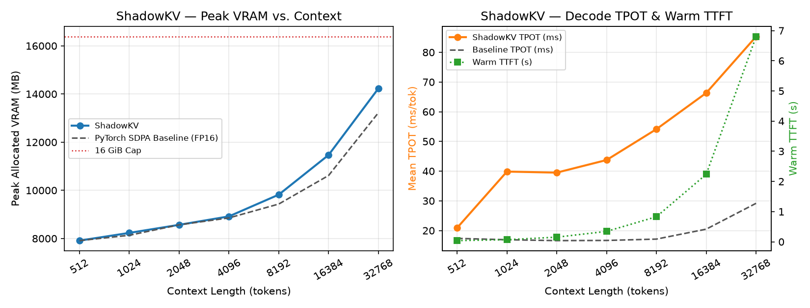
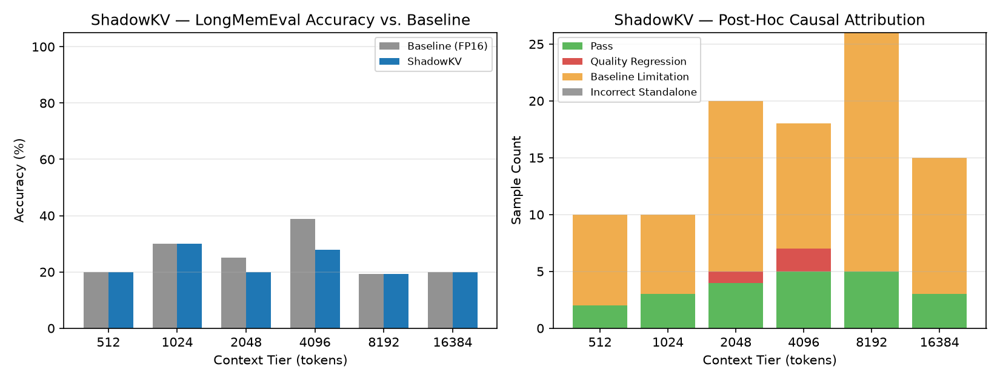

# WP3-7: ShadowKV

**Primary Axis:** `SPATIAL` | **All Axes:** `SPATIAL, STRUCTURAL, TEMPORAL` | **Model:** `Qwen3-4B-Instruct-2507` (16.0 GiB Cap, PyTorch Native SDPA)

**Artifact Provenance (SHA-256):** `shadowkv_hardware_pytorch_16gb.json`: `UPDATED (post-manifest re-run)` (`6a7bbf2b1eae…`) | `shadowkv_longmem_pytorch_16gb.json`: `UPDATED (post-manifest re-run)` (`a9d68344f853…`) | `shadowkv_niah_pytorch_16gb.json`: `UPDATED (post-manifest re-run)` (`fa78e110f6c6…`)

---

## 1. What It Does & How (Brief)

ShadowKV keeps low-rank SVD-compressed Key representations and sparse outlier channels on the GPU for fast chunk-level relevance scoring, while offloading full-precision Values to CPU RAM and fetching only the top-k relevant chunks on demand during decode.

- **Evaluated Configuration:** `svd_rank=160`, `chunk_size=8`, `topk_chunks=256`, `outlier_ratio=0.003`

---

## 2. Empirical Results

### 2.1 Hardware Metric Sweep (512 → 32,768)

| Context | Status | Peak Alloc (MB) | Peak Reserved (MB) | Warm TTFT (s) | Cold TTFT (s) | TPOT Mean (ms) | TPOT P95 (ms) | Throughput (tok/s) | Host RSS Δ (MB) | Memcpy (B/tok) |
|---:|:---:|---:|---:|---:|---:|---:|---:|---:|---:|---:|
| 512 | SUCCESS | 7911.7 | 7998.0 | 0.038 | 0.000 | 20.90 | 20.90 | 47.84 | 1682.5 | 201.8 |
| 1024 | SUCCESS | 8232.5 | 8866.0 | 0.070 | 0.000 | 39.85 | 39.85 | 25.10 | 2450.7 | 2593806.4 |
| 2048 | SUCCESS | 8566.9 | 9318.0 | 0.152 | 0.000 | 39.50 | 39.50 | 25.31 | 2457.0 | 5244844.6 |
| 4096 | SUCCESS | 8918.2 | 10006.0 | 0.344 | 0.000 | 43.74 | 43.74 | 22.86 | 2674.4 | 9982381.6 |
| 8192 | SUCCESS | 9821.0 | 10990.0 | 0.829 | 0.000 | 54.13 | 54.13 | 18.47 | 3238.3 | 19339027.3 |
| 16384 | SUCCESS | 11468.3 | 12932.0 | 2.237 | 0.000 | 66.32 | 66.32 | 15.08 | 3942.8 | 36767998.9 |
| 32768 | SUCCESS | 14233.0 | 16124.0 | 6.802 | 0.000 | 85.29 | 85.29 | 11.73 | 5325.1 | 67241955.2 |

### 2.2 KL Divergence & Logit Fidelity

#### PG-19 Hardware Sweep

| Context | KL Div Mean | KL Div P99 | Top-1 Agreement (%) |
|---:|---:|---:|---:|
| 512 | 0.0000 | 0.0000 | 100.00 |
| 1024 | 10.6381 | 15.4247 | 25.00 |
| 2048 | 7.9431 | 15.4249 | 40.62 |
| 4096 | 4.1498 | 15.1387 | 68.75 |
| 8192 | 0.0513 | 0.8673 | 100.00 |
| 16384 | 1.5682 | 14.4418 | 87.50 |
| 32768 | 12.9090 | 15.4249 | 7.81 |

#### LongMemEval Conversational Sweep

| Context Tier | KL Div Mean | KL Div P99 | Top-1 Agreement (%) |
|---:|---:|---:|---:|
| 512 | 0.0000 | 0.0000 | 100.00 |
| 1024 | 0.0000 | 0.0000 | 100.00 |
| 2048 | 6.2979 | 15.4249 | 54.37 |
| 4096 | 6.8981 | 15.4249 | 49.65 |
| 8192 | 5.0667 | 15.4249 | 62.74 |
| 16384 | 4.8172 | 15.4249 | 64.17 |

### 2.3 Needle-In-A-Haystack (NIAH) 2D Sweep

| Depth \ Context | 2048 | 4096 |
|---:|:---:|:---:|
| 0.0 | PASS | PASS |
| 0.1 | PASS | PASS |
| 0.2 | PASS | PASS |
| 0.3 | PASS | PASS |
| 0.4 | PASS | PASS |
| 0.5 | PASS | PASS |
| 0.6 | PASS | PASS |
| 0.7 | PASS | PASS |
| 0.8 | PASS | PASS |
| 0.9 | PASS | PASS |
| **Overall Accuracy** | **100.0%** | **100.0%** |

### 2.4 LongMemEval & Post-Hoc Diagnostics

| Context Tier | Acc | F1 | Pass / Total | Quality Regressions | Baseline Limitations | Mean Retention | Eff. Bitwidth |
|---:|---:|---:|:---:|---:|---:|---:|---:|
| 512 | 0.20 | 0.12 | 2/10 | 0 | 8 | 1.00 | 16.00 |
| 1024 | 0.30 | 0.13 | 3/10 | 0 | 7 | 1.00 | 16.00 |
| 2048 | 0.20 | 0.11 | 4/20 | 1 | 15 | 1.00 | 16.00 |
| 4096 | 0.28 | 0.07 | 5/18 | 2 | 11 | 1.00 | 16.00 |
| 8192 | 0.19 | 0.07 | 5/26 | 0 | 21 | 1.00 | 16.00 |
| 16384 | 0.20 | 0.10 | 3/15 | 0 | 12 | 1.00 | 16.00 |

#### 5-Capability Accuracy Breakdown (Sample-Weighted Across Context Tiers)

| Capability | Samples | Technique Acc | Baseline Acc | Δ vs. Baseline |
|---|---:|---:|---:|---:|
| `fact_recall` | 22 | 40.9% | 50.0% | -9.1% |
| `cross_session_reasoning` | 16 | 6.2% | 6.2% | +0.0% |
| `information_update` | 20 | 45.0% | 45.0% | +0.0% |
| `relative_timeframe` | 19 | 15.8% | 21.1% | -5.3% |
| `unanswerable_refusal` | 22 | 0.0% | 0.0% | +0.0% |

---

## 3. Diagnostic Analysis & Metric-Backed Pros/Cons

### Why It Is Better or Worse Than Baseline

Tested with svd_rank=160, chunk_size=8, topk_chunks=256, and outlier_ratio=0.003. This design aims to combine full-sequence recall (via CPU Value backing) with low GPU VRAM footprint and selective temporal chunk retrieval.

On the 2D NIAH diagnostic sweep, exact-match retrieval across depths 0.0–0.9 is **2048: 100%, 4096: 100%**.

On LongMemEval (99 inspected samples across 512–16,384 tokens), ShadowKV scores **22/99** with **3** quality regressions relative to the uncompressed baseline (25/99) and a mean token retention ratio of **1.00**.

### Pros

- Low PG-19 logit drift (mean KL = **5.32**, Top-1 = **61.4%**).
- Achieves **100% NIAH exact-match retrieval** across all depths (0.0–0.9) at both 2,048 and 4,096 context lengths.

### Cons

- Increases peak allocated VRAM at 32K by **+7.6%** (14233 MB vs. 13225 MB baseline) due to auxiliary metadata/prefetch buffers.
- Decode latency at 32K is **2.92x slower** than baseline (**85.3 ms/tok** vs. 29.2 ms/tok).
- High host-device transfer volume at 32K (**67241955 B/tok**, Host RSS Δ = **5325 MB**).
- Trails baseline LongMemEval pass count (**22/99** vs. 25/99 baseline) with **3** quality regressions (mean KV retention ratio = **1.00**).
