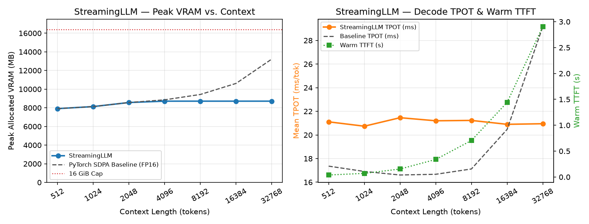

# WP3-1: StreamingLLM

**Primary Axis:** `STRUCTURAL` | **All Axes:** `STRUCTURAL` | **Model:** `Qwen3-4B-Instruct-2507` (16.0 GiB Cap, PyTorch Native SDPA)

**Artifact Provenance (SHA-256):** `streamingllm_hardware_pytorch_16gb.json`: `VERIFIED` (`05bd5adb4d50…`) | `streamingllm_longmem_pytorch_16gb.json`: `UPDATED (post-manifest re-run)` (`de2705b9dc34…`) | `streamingllm_niah_pytorch_16gb.json`: `VERIFIED` (`5f01cee56d9e…`)

---

## 1. What It Does & How (Brief)

StreamingLLM retains a small set of initial 'attention sink' tokens alongside a fixed-size rolling sliding window of the most recent tokens. When the sequence exceeds the combined budget, intermediate tokens between the sinks and the local window are evicted in FIFO order, bounding KV-cache memory to O(1) regardless of prompt length.

- **Evaluated Configuration:** `sink_tokens=4`, `window_size=2048`, `block_size=16`, `effective_cache_tokens=2052`, `effective_sliding_window=2064`

---

## 2. Empirical Results

### 2.1 Hardware Metric Sweep (512 → 32,768)

| Context | Status | Peak Alloc (MB) | Peak Reserved (MB) | Warm TTFT (s) | Cold TTFT (s) | TPOT Mean (ms) | TPOT P95 (ms) | Throughput (tok/s) | Host RSS Δ (MB) | Memcpy (B/tok) |
|---:|:---:|---:|---:|---:|---:|---:|---:|---:|---:|---:|
| 512 | SUCCESS | 7911.7 | 7998.0 | 0.039 | 0.000 | 21.11 | 21.11 | 47.37 | 1104.6 | 201.8 |
| 1024 | SUCCESS | 8133.0 | 8164.0 | 0.070 | 0.000 | 20.74 | 20.74 | 48.22 | 1104.7 | 329.8 |
| 2048 | SUCCESS | 8566.9 | 8624.0 | 0.154 | 0.000 | 21.46 | 21.46 | 46.61 | 1149.9 | 585.8 |
| 4096 | SUCCESS | 8711.5 | 8924.0 | 0.339 | 0.000 | 21.20 | 21.20 | 47.18 | 1048.2 | 1097.8 |
| 8192 | SUCCESS | 8711.5 | 9104.0 | 0.705 | 0.000 | 21.23 | 21.23 | 47.09 | 1186.2 | 2121.8 |
| 16384 | SUCCESS | 8711.6 | 9104.0 | 1.441 | 0.000 | 20.90 | 20.90 | 47.84 | 1233.8 | 4169.8 |
| 32768 | SUCCESS | 8711.7 | 9124.0 | 2.905 | 0.000 | 20.95 | 20.95 | 47.73 | 1326.5 | 8265.8 |

### 2.2 KL Divergence & Logit Fidelity

#### PG-19 Hardware Sweep

| Context | KL Div Mean | KL Div P99 | Top-1 Agreement (%) |
|---:|---:|---:|---:|
| 512 | 0.0000 | 0.0000 | 100.00 |
| 1024 | 0.0000 | 0.0000 | 100.00 |
| 2048 | 11.1998 | 15.4249 | 17.19 |
| 4096 | 3.2542 | 15.1387 | 75.00 |
| 8192 | 9.8077 | 15.4249 | 29.69 |
| 16384 | 10.5379 | 15.4249 | 25.00 |
| 32768 | 13.3844 | 15.4249 | 6.25 |

#### LongMemEval Conversational Sweep

| Context Tier | KL Div Mean | KL Div P99 | Top-1 Agreement (%) |
|---:|---:|---:|---:|
| 32768 | 12.9800 | 15.4249 | 13.18 |

### 2.3 Needle-In-A-Haystack (NIAH) 2D Sweep

| Depth \ Context | 2048 | 4096 |
|---:|:---:|:---:|
| 0.0 | PASS | FAIL |
| 0.1 | PASS | FAIL |
| 0.2 | PASS | FAIL |
| 0.3 | PASS | FAIL |
| 0.4 | PASS | FAIL |
| 0.5 | PASS | FAIL |
| 0.6 | PASS | PASS |
| 0.7 | PASS | PASS |
| 0.8 | PASS | PASS |
| 0.9 | PASS | PASS |
| **Overall Accuracy** | **100.0%** | **40.0%** |

### 2.4 LongMemEval & Post-Hoc Diagnostics

**LongMemEval (150 Quantile-Sampled Official Questions, Single-Pass Native Length @ 32K, Chat Template, `max_tokens=128`, Semantic Graded):**

| Context Ceiling | Semantic Acc | Pass / Total | Quality Regressions | Baseline Limitations | Unexpected Gains | EOS Clean Stops | Mean Retention | Eff. Bitwidth |
|---:|---:|:---:|---:|---:|---:|:---:|---:|---:|
| 32768 | **44.0%** | **66/150** | 37 | 47 | 4 | 88/150 | 0.43 | 6.80 |

#### 5-Capability Semantic Accuracy Breakdown (30 Official Questions / Capability)

| Capability | Samples | Technique Acc | Baseline Acc | Δ vs. Baseline |
|---|---:|---:|---:|---:|
| `fact_recall` | 30 | 70.0% | 90.0% | -20.0% |
| `cross_session_reasoning` | 30 | 3.3% | 43.3% | -40.0% |
| `information_update` | 30 | 60.0% | 66.7% | -6.7% |
| `relative_timeframe` | 30 | 10.0% | 30.0% | -20.0% |
| `unanswerable_refusal` | 30 | 76.7% | 100.0% | -23.3% |

---

## 3. Diagnostic Analysis & Metric-Backed Pros/Cons

### Why It Is Better or Worse Than Baseline

Tested with 4 sink tokens and a 2,048-token sliding window (2,052 effective tokens). Because eviction is purely positional without content scoring, any information outside the initial 4 tokens or the trailing 2,048-token window is permanently discarded.

On the 2D NIAH diagnostic sweep, exact-match retrieval across depths 0.0–0.9 is **2048: 100%, 4096: 40%**.

On LongMemEval (150 quantile-sampled official questions at native length up to 32K, chat-templated, `max_tokens=128`, semantically graded), StreamingLLM achieves **66/150 (44.0%)** vs. baseline **99/150 (66.0%)**, with **37** quality regressions and mean KV retention ratio **0.43**.

### Pros

- Reduces peak allocated VRAM at 32K by **34.1%** (8712 MB vs. 13225 MB baseline).
- Decode latency at 32K is faster or at parity with baseline (**20.9 ms/tok** vs. 29.2 ms/tok, 1.39x speed).

### Cons

- Elevated PG-19 logit divergence (mean KL = **6.88**, Top-1 = **50.4%**).
- NIAH retrieval drops to **40%** at 4,096 tokens (failing at depths `[0.0, 0.1, 0.2, 0.3, 0.4, 0.5]`), confirming loss of early/non-local needle tokens.
- Degrades LongMemEval semantic accuracy to **66/150 (44.0%)** vs. 99/150 (66.0%) baseline (**37** quality regressions).
