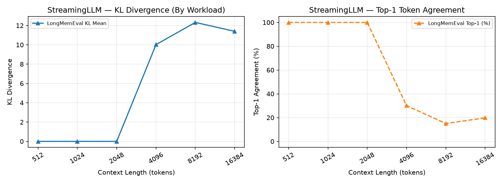
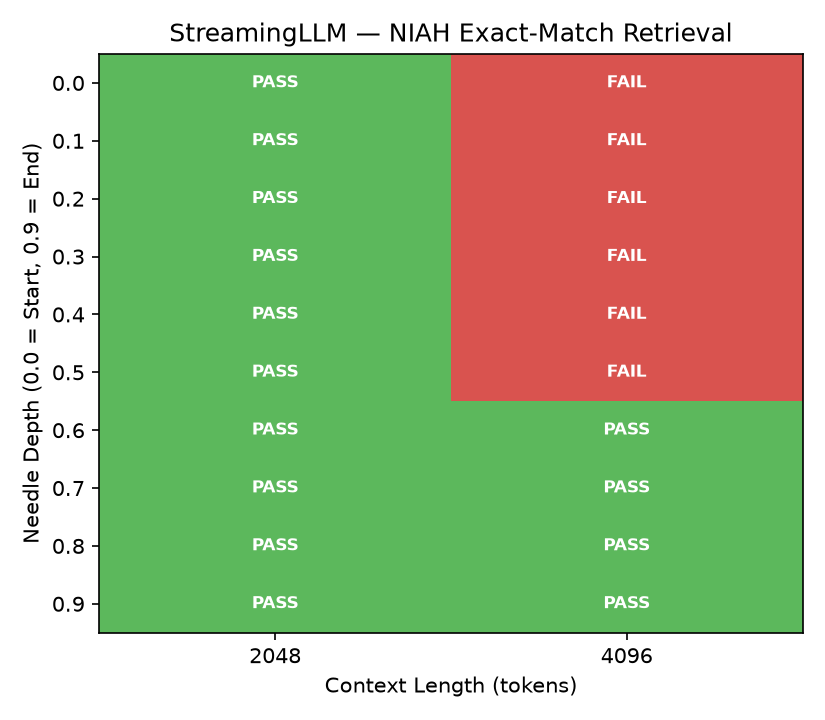
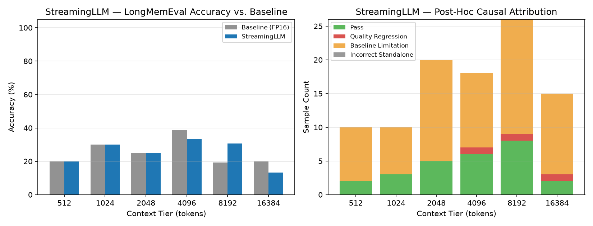

# WP3-1: StreamingLLM

**Primary Axis:** `STRUCTURAL` | **All Axes:** `STRUCTURAL` | **Model:** `Qwen3-4B-Instruct-2507` (16.0 GiB Cap, PyTorch Native SDPA)

**Artifact Provenance (SHA-256):** `streamingllm_hardware_pytorch_16gb.json`: `UPDATED (post-manifest re-run)` (`c329edff7e83…`) | `streamingllm_longmem_pytorch_16gb.json`: `UPDATED (post-manifest re-run)` (`fd5ddd1381cf…`) | `streamingllm_niah_pytorch_16gb.json`: `UNMANIFESTED` (`5f01cee56d9e…`)

---

## 1. What It Does & How (Brief)

StreamingLLM retains a small set of initial 'attention sink' tokens alongside a fixed-size rolling sliding window of the most recent tokens. When the sequence exceeds the combined budget, intermediate tokens between the sinks and the local window are evicted in FIFO order, bounding KV-cache memory to O(1) regardless of prompt length.

- **Evaluated Configuration:** `sink_tokens=4`, `window_size=2048`, `block_size=16`, `effective_cache_tokens=2052`, `effective_sliding_window=2064`

---

## 2. Empirical Results

### 2.1 Hardware Metric Sweep (512 → 32,768)

| Context | Status | Peak Alloc (MB) | Peak Reserved (MB) | Warm TTFT (s) | Cold TTFT (s) | TPOT Mean (ms) | TPOT P95 (ms) | Throughput (tok/s) | Host RSS Δ (MB) | Memcpy (B/tok) |
|---:|:---:|---:|---:|---:|---:|---:|---:|---:|---:|---:|
| 512 | SUCCESS | 7992.5 | 8098.0 | 0.038 | 0.000 | 15.49 | 15.49 | 64.56 | 3521.8 | 201.8 |
| 1024 | SUCCESS | 8285.9 | 8404.0 | 0.070 | 0.000 | 15.25 | 15.25 | 65.56 | 3521.8 | 329.8 |
| 2048 | SUCCESS | 8855.5 | 8924.0 | 0.154 | 0.000 | 16.03 | 16.03 | 62.38 | 3752.6 | 585.8 |
| 4096 | SUCCESS | 9000.1 | 9224.0 | 0.337 | 0.000 | 16.03 | 16.03 | 62.38 | 3858.5 | 1097.8 |
| 8192 | SUCCESS | 9000.1 | 9224.0 | 0.705 | 0.000 | 16.06 | 16.06 | 62.25 | 4057.9 | 2121.8 |
| 16384 | SUCCESS | 9000.1 | 9404.0 | 1.493 | 0.000 | 16.01 | 16.01 | 62.46 | 4461.9 | 4169.8 |
| 32768 | SUCCESS | 9000.3 | 9404.0 | 3.010 | 0.000 | 15.82 | 15.82 | 63.21 | 5267.5 | 8265.8 |

### 2.2 KL Divergence & Logit Fidelity

#### LongMemEval Conversational Sweep

| Context Tier | KL Div Mean | KL Div P99 | Top-1 Agreement (%) |
|---:|---:|---:|---:|
| 512 | 0.0000 | 0.0000 | 100.00 |
| 1024 | 0.0000 | 0.0000 | 100.00 |
| 2048 | 0.0000 | 0.0000 | 100.00 |
| 4096 | 10.0221 | 15.4249 | 30.03 |
| 8192 | 12.3219 | 15.4249 | 15.02 |
| 16384 | 11.3996 | 15.4249 | 19.79 |

### 2.3 Needle-In-A-Haystack (NIAH) 2D Sweep

| Depth \ Context | 2048 | 4096 |
|---:|:---:|:---:|
| 0.0 | PASS | FAIL |
| 0.1 | PASS | FAIL |
| 0.2 | PASS | FAIL |
| 0.3 | PASS | FAIL |
| 0.4 | PASS | FAIL |
| 0.5 | PASS | FAIL |
| 0.6 | PASS | PASS |
| 0.7 | PASS | PASS |
| 0.8 | PASS | PASS |
| 0.9 | PASS | PASS |
| **Overall Accuracy** | **100.0%** | **40.0%** |

### 2.4 LongMemEval & Post-Hoc Diagnostics

| Context Tier | Acc | F1 | Pass / Total | Quality Regressions | Baseline Limitations | Mean Retention | Eff. Bitwidth |
|---:|---:|---:|:---:|---:|---:|---:|---:|
| 512 | 0.20 | 0.12 | 2/10 | 0 | 8 | 1.00 | 16.00 |
| 1024 | 0.30 | 0.13 | 3/10 | 0 | 7 | 1.00 | 16.00 |
| 2048 | 0.25 | 0.13 | 5/20 | 0 | 15 | 1.00 | 16.00 |
| 4096 | 0.33 | 0.09 | 6/18 | 1 | 11 | 0.60 | 9.60 |
| 8192 | 0.31 | 0.08 | 8/26 | 1 | 17 | 0.30 | 4.81 |
| 16384 | 0.13 | 0.08 | 2/15 | 1 | 12 | 0.15 | 2.39 |

#### 5-Capability Accuracy Breakdown (Sample-Weighted Across Context Tiers)

| Capability | Samples | Technique Acc | Baseline Acc | Δ vs. Baseline |
|---|---:|---:|---:|---:|
| `fact_recall` | 22 | 45.5% | 50.0% | -4.5% |
| `cross_session_reasoning` | 16 | 0.0% | 6.2% | -6.2% |
| `information_update` | 20 | 50.0% | 45.0% | +5.0% |
| `relative_timeframe` | 19 | 31.6% | 21.1% | +10.5% |
| `unanswerable_refusal` | 22 | 0.0% | 0.0% | +0.0% |

---

## 3. Diagnostic Analysis & Metric-Backed Pros/Cons

### Why It Is Better or Worse Than Baseline

Tested with 4 sink tokens and a 2,048-token sliding window (2,052 effective tokens). Because eviction is purely positional without content scoring, any information outside the initial 4 tokens or the trailing 2,048-token window is permanently discarded.

On the 2D NIAH diagnostic sweep, exact-match retrieval across depths 0.0–0.9 is **2048: 100%, 4096: 40%**.

On LongMemEval (99 inspected samples across 512–16,384 tokens), StreamingLLM scores **26/99** with **3** quality regressions relative to the uncompressed baseline (25/99) and a mean token retention ratio of **0.68**.

### Pros

- Reduces peak allocated VRAM at 32K by **31.9%** (9000 MB vs. 13225 MB baseline).
- Decode latency at 32K is faster or at parity with baseline (**15.8 ms/tok** vs. 29.2 ms/tok, 1.84x speed).
- Low LongMemEval logit drift (mean KL = **5.62**, Top-1 = **60.8%**).
- Matches or exceeds baseline LongMemEval pass count (**26/99** vs. 25/99 baseline) with **3** compression-induced quality regressions.

### Cons

- NIAH retrieval drops to **40%** at 4,096 tokens (failing at depths `[0.0, 0.1, 0.2, 0.3, 0.4, 0.5]`), confirming loss of early/non-local needle tokens.
