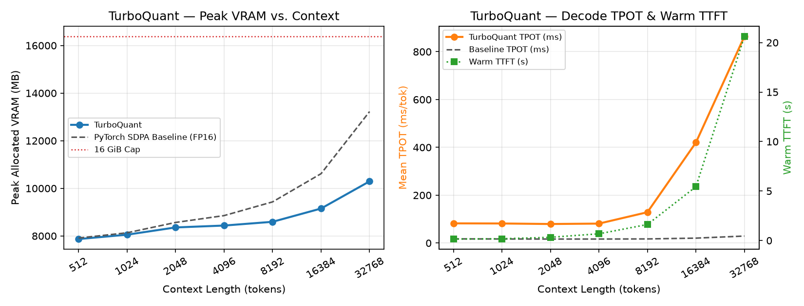
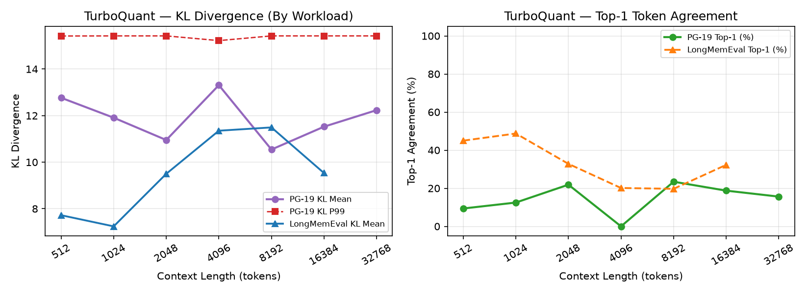
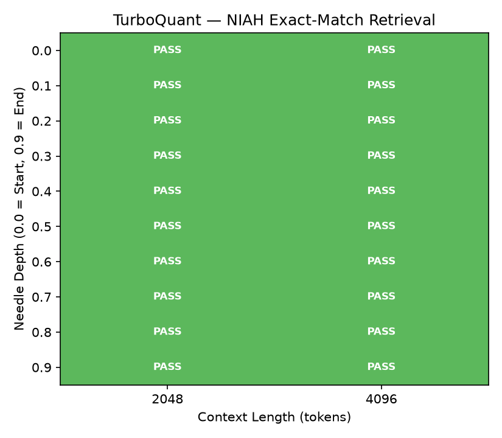
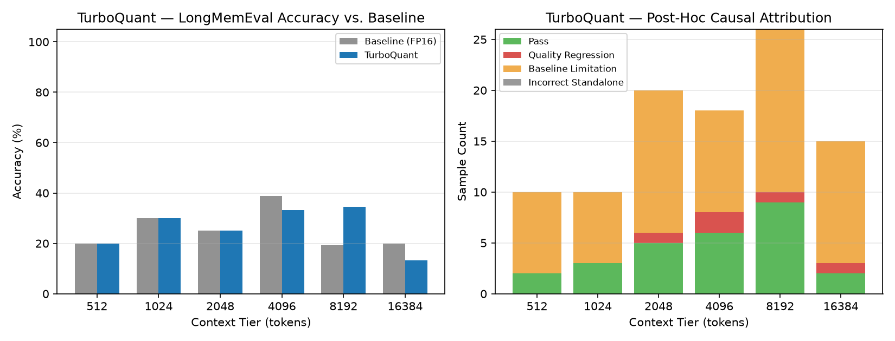

# WP3-3: TurboQuant

**Primary Axis:** `STRUCTURAL` | **All Axes:** `STRUCTURAL` | **Model:** `Qwen3-4B-Instruct-2507` (16.0 GiB Cap, PyTorch Native SDPA)

**Artifact Provenance (SHA-256):** `turboquant_hardware_pytorch_16gb.json`: `UPDATED (post-manifest re-run)` (`6dfdb5bbd319…`) | `turboquant_longmem_pytorch_16gb.json`: `UPDATED (post-manifest re-run)` (`0864eb6d8baf…`) | `turboquant_niah_pytorch_16gb.json`: `UPDATED (post-manifest re-run)` (`08562dd7526b…`)

---

## 1. What It Does & How (Brief)

TurboQuant applies asymmetric low-bit quantization to Keys and Values, using a Walsh-Hadamard rotation to smooth outlier channels before quantization and a Quantized Johnson-Lindenstrauss (QJL) sketch on Values to preserve inner-product fidelity.

- **Evaluated Configuration:** `k_bits=4`, `v_bits=3`, `qjl_v=True`, `qjl_k=False`, `block_size=16`, `compression_ratio=3.657`, `theoretical_bytes_per_token_head=140`

---

## 2. Empirical Results

### 2.1 Hardware Metric Sweep (512 → 32,768)

| Context | Status | Peak Alloc (MB) | Peak Reserved (MB) | Warm TTFT (s) | Cold TTFT (s) | TPOT Mean (ms) | TPOT P95 (ms) | Throughput (tok/s) | Host RSS Δ (MB) | Memcpy (B/tok) |
|---:|:---:|---:|---:|---:|---:|---:|---:|---:|---:|---:|
| 512 | SUCCESS | 7869.6 | 7892.0 | 0.148 | 0.000 | 82.25 | 82.25 | 12.16 | 4816.1 | 4922.2 |
| 1024 | SUCCESS | 8053.1 | 8074.0 | 0.177 | 0.000 | 81.73 | 81.73 | 12.24 | 4816.2 | 5050.2 |
| 2048 | SUCCESS | 8358.0 | 8388.0 | 0.327 | 0.000 | 79.53 | 79.53 | 12.57 | 4678.9 | 5315.2 |
| 4096 | SUCCESS | 8436.8 | 8688.0 | 0.677 | 0.000 | 81.24 | 81.24 | 12.31 | 4969.8 | 5845.2 |
| 8192 | SUCCESS | 8594.3 | 8888.0 | 1.619 | 0.000 | 128.84 | 128.84 | 7.76 | 5159.3 | 6905.2 |
| 16384 | SUCCESS | 9152.2 | 9408.0 | 5.436 | 0.000 | 420.20 | 420.20 | 2.38 | 6146.4 | 9025.2 |
| 32768 | SUCCESS | 10294.4 | 10732.0 | 20.627 | 0.000 | 864.12 | 864.12 | 1.16 | 7528.9 | 13265.2 |

### 2.2 KL Divergence & Logit Fidelity

#### PG-19 Hardware Sweep

| Context | KL Div Mean | KL Div P99 | Top-1 Agreement (%) |
|---:|---:|---:|---:|
| 512 | 12.7666 | 15.4200 | 9.38 |
| 1024 | 11.9099 | 15.4249 | 12.50 |
| 2048 | 10.9512 | 15.4249 | 21.88 |
| 4096 | 13.3091 | 15.2225 | 0.00 |
| 8192 | 10.5429 | 15.4249 | 23.44 |
| 16384 | 11.5250 | 15.4249 | 18.75 |
| 32768 | 12.2347 | 15.4249 | 15.62 |

#### LongMemEval Conversational Sweep

| Context Tier | KL Div Mean | KL Div P99 | Top-1 Agreement (%) |
|---:|---:|---:|---:|
| 512 | 7.7213 | 15.4249 | 45.00 |
| 1024 | 7.2420 | 15.4249 | 48.75 |
| 2048 | 9.4998 | 15.4249 | 32.81 |
| 4096 | 11.3518 | 15.4249 | 20.14 |
| 8192 | 11.4929 | 15.4249 | 19.71 |
| 16384 | 9.5310 | 15.4249 | 32.29 |

### 2.3 Needle-In-A-Haystack (NIAH) 2D Sweep

| Depth \ Context | 2048 | 4096 |
|---:|:---:|:---:|
| 0.0 | PASS | PASS |
| 0.1 | PASS | PASS |
| 0.2 | PASS | PASS |
| 0.3 | PASS | PASS |
| 0.4 | PASS | PASS |
| 0.5 | PASS | PASS |
| 0.6 | PASS | PASS |
| 0.7 | PASS | PASS |
| 0.8 | PASS | PASS |
| 0.9 | PASS | PASS |
| **Overall Accuracy** | **100.0%** | **100.0%** |

### 2.4 LongMemEval & Post-Hoc Diagnostics

| Context Tier | Acc | F1 | Pass / Total | Quality Regressions | Baseline Limitations | Mean Retention | Eff. Bitwidth |
|---:|---:|---:|:---:|---:|---:|---:|---:|
| 512 | 0.20 | 0.10 | 2/10 | 0 | 8 | 1.00 | 16.00 |
| 1024 | 0.30 | 0.12 | 3/10 | 0 | 7 | 1.00 | 16.00 |
| 2048 | 0.25 | 0.11 | 5/20 | 1 | 14 | 1.00 | 16.00 |
| 4096 | 0.33 | 0.08 | 6/18 | 2 | 10 | 1.00 | 16.00 |
| 8192 | 0.35 | 0.10 | 9/26 | 1 | 16 | 1.00 | 16.00 |
| 16384 | 0.13 | 0.11 | 2/15 | 1 | 12 | 1.00 | 16.00 |

#### 5-Capability Accuracy Breakdown (Sample-Weighted Across Context Tiers)

| Capability | Samples | Technique Acc | Baseline Acc | Δ vs. Baseline |
|---|---:|---:|---:|---:|
| `fact_recall` | 22 | 45.5% | 50.0% | -4.5% |
| `cross_session_reasoning` | 16 | 6.2% | 6.2% | +0.0% |
| `information_update` | 20 | 60.0% | 45.0% | +15.0% |
| `relative_timeframe` | 19 | 21.1% | 21.1% | -0.0% |
| `unanswerable_refusal` | 22 | 0.0% | 0.0% | +0.0% |

---

## 3. Diagnostic Analysis & Metric-Backed Pros/Cons

### Why It Is Better or Worse Than Baseline

Tested at 4-bit Keys and 3-bit Values (qjl_v=True, qjl_k=False, ~3.66x theoretical compression, 140 B/token-head). All tokens remain resident in the cache rather than being evicted, trading Python-level dequantization/rotation latency for full-context retention.

On the 2D NIAH diagnostic sweep, exact-match retrieval across depths 0.0–0.9 is **2048: 100%, 4096: 100%**.

On LongMemEval (99 inspected samples across 512–16,384 tokens), TurboQuant scores **27/99** with **5** quality regressions relative to the uncompressed baseline (25/99) and a mean token retention ratio of **1.00**.

### Pros

- Reduces peak allocated VRAM at 32K by **22.2%** (10294 MB vs. 13225 MB baseline).
- Achieves **100% NIAH exact-match retrieval** across all depths (0.0–0.9) at both 2,048 and 4,096 context lengths.
- Matches or exceeds baseline LongMemEval pass count (**27/99** vs. 25/99 baseline) with **5** compression-induced quality regressions.

### Cons

- Decode latency at 32K is **29.62x slower** than baseline (**864.1 ms/tok** vs. 29.2 ms/tok).
- High host-device transfer volume at 32K (**13265 B/tok**, Host RSS Δ = **7529 MB**).
- Elevated PG-19 logit divergence (mean KL = **11.89**, Top-1 = **14.5%**).
